# Proyecto Integrador: Onboarding de Clientes Personas Físicas

API REST en Java / Spring Boot para registrar clientes personas físicas, validar su información, crear automáticamente una cuenta bancaria asociada con saldo inicial y autenticar a los usuarios (contraseña o Face ID).

> **Historia de usuario.** Como ejecutivo de una institución financiera, necesito registrar clientes personas físicas en el sistema para asignarles una cuenta bancaria y permitirles realizar operaciones financieras.

## Entregables

| Entregable | Dónde se encuentra |
|---|---|
| Diagrama entidad-relación | [Sección 3](#3-diagrama-entidad-relación) · imagen: [`docs/base_de_datos/diagrama_er.png`](docs/base_de_datos/diagrama_er.png) |
| Script de creación de base de datos | [Sección 4](#4-base-de-datos) · archivo: [`docs/base_de_datos/script_creacion_bd.sql`](docs/base_de_datos/script_creacion_bd.sql) · migraciones Flyway: [`src/main/resources/db/migration`](src/main/resources/db/migration) |
| Código fuente completo | Este repositorio · estructura en la [Sección 10](#10-estructura-del-código-fuente) |
| API REST funcional | [Sección 5](#5-api-rest) · Swagger UI: `http://localhost:8081/swagger-ui.html` |
| Evidencias de pruebas realizadas | [Sección 9](#9-evidencias-de-pruebas) · carpeta [`docs/evidencias`](docs/evidencias) |
| Documento técnico | [`docs/Documento_Tecnico_Onboarding.docx`](docs/Documento_Tecnico_Onboarding.docx) |

---

## 1. Tecnologías

| Tecnología | Versión / uso |
|---|---|
| Java | 17 (compila también con 21) |
| Spring Boot | 3.3.6 (Web, Validation, Data JPA) |
| Hibernate / JPA | 6.5 |
| PostgreSQL | 14 o superior |
| Flyway | Migraciones versionadas del esquema |
| Gradle | Wrapper incluido (`gradlew` / `gradlew.bat`) |
| Lombok | Reducción de código repetitivo en entidades y DTO |
| springdoc-openapi | Swagger UI / OpenAPI 3 |
| JUnit 5 + Mockito | Pruebas unitarias |

## 2. Cómo ejecutar

1. **Crear la base de datos** en PostgreSQL:
   ```sql
   CREATE DATABASE pago_servicios_db;
   ```
   Las tablas las crea **Flyway automáticamente** al arrancar (migraciones `V3`, `V8`, `V9` y `V10`). Para crearla manualmente se puede usar [`docs/base_de_datos/script_creacion_bd.sql`](docs/base_de_datos/script_creacion_bd.sql).
2. **Configurar la conexión** en `src/main/resources/application.properties` (`spring.datasource.url`, `username`, `password`). El puerto de la API es `8081`.
3. **Definir el usuario ejecutivo inicial** con variables de entorno (nunca en el código ni en `application.properties`):
   ```powershell
   $env:APP_EJECUTIVO_USUARIO  = "ejecutivo.admin"
   $env:APP_EJECUTIVO_PASSWORD = "Ejecutivo#2026"   # mín. 8 caracteres, 1 mayúscula, 1 minúscula, 1 número y 1 carácter especial
   ```
   Al arrancar se crea ese usuario con rol `EJECUTIVO` si no existe. Sin él, las operaciones de actualizar, baja y consulta solo estarán disponibles para cada cliente sobre su propio registro (ver [sección 5.6](#56-autenticación-y-autorización-control-de-acceso-por-recurso)).
4. **Compilar, probar y arrancar:**
   ```powershell
   .\gradlew.bat clean test      # pruebas unitarias
   .\gradlew.bat bootRun         # levanta la API en http://localhost:8081
   ```
5. **Probar la API** desde Swagger UI: `http://localhost:8081/swagger-ui.html`. Para las operaciones protegidas: iniciar sesión en `POST /api/v1/auth/login`, copiar `data.token` y pegarlo en el botón **Authorize**.

---

## 3. Diagrama entidad-relación

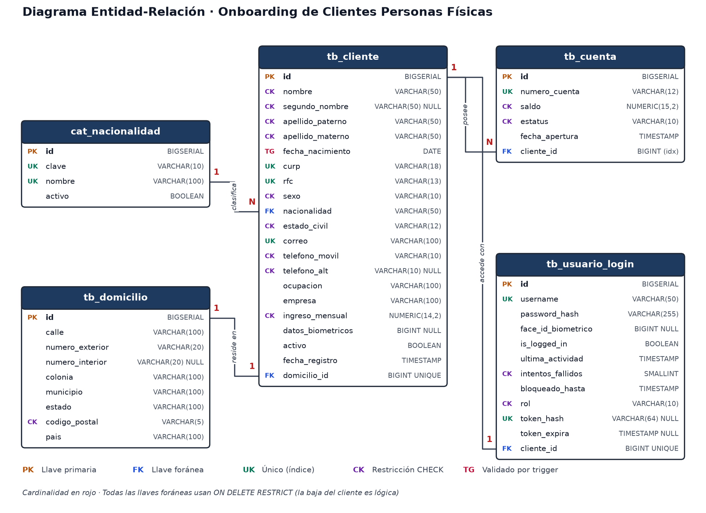

Versión en Mermaid (GitHub la dibuja automáticamente):

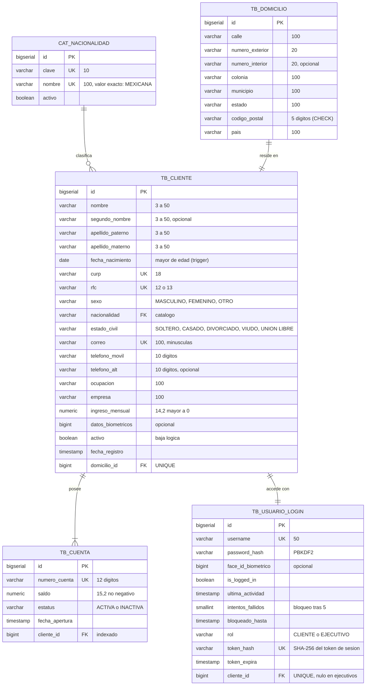

| Relación | Cardinalidad | Implementación |
|---|---|---|
| `cat_nacionalidad` → `tb_cliente` | 1 : N | FK `tb_cliente.nacionalidad` → `cat_nacionalidad.nombre` |
| `tb_domicilio` → `tb_cliente` | 1 : 1 | FK `tb_cliente.domicilio_id` con `UNIQUE` |
| `tb_cliente` → `tb_cuenta` | 1 : N (al menos una, creada en el alta) | FK `tb_cuenta.cliente_id` + índice `idx_cuenta_cliente` |
| `tb_cliente` → `tb_usuario_login` | 1 : 1 | FK `tb_usuario_login.cliente_id` con `UNIQUE` |

Todas las llaves foráneas usan `ON DELETE RESTRICT`: la información nunca se borra físicamente, la baja es lógica (`activo = FALSE`).

---

## 4. Base de datos

### 4.1 Script de creación

- **Script consolidado** (crear la base desde cero): [`docs/base_de_datos/script_creacion_bd.sql`](docs/base_de_datos/script_creacion_bd.sql)
- **Migraciones que ejecuta la aplicación** (Flyway): `V3__create_onboarding_cliente.sql`, `V8__create_cat_nacionalidad.sql` y `V9__endurecer_onboarding_cliente.sql` en [`src/main/resources/db/migration`](src/main/resources/db/migration). La `V9` endurece una base ya existente sin perder datos: normaliza registros históricos y crea las restricciones con `NOT VALID` para no fallar por datos capturados con reglas anteriores.

<details>
<summary><b>Ver el script completo</b></summary>

Contenido íntegro en [`docs/base_de_datos/script_creacion_bd.sql`](docs/base_de_datos/script_creacion_bd.sql). Resumen de su estructura:

1. `cat_nacionalidad` + 11 registros iniciales (MEXICANA, ESTADOUNIDENSE, COLOMBIANA, ARGENTINA, ESPAÑOLA, CANADIENSE, CUBANA, VENEZOLANA, PERUANA, GUATEMALTECA, EXTRANJERA).
2. `tb_domicilio` con `CHECK` de código postal.
3. `tb_cliente` con 4 `UNIQUE`, 2 llaves foráneas y 13 restricciones `CHECK`.
4. `tb_cuenta` con `UNIQUE`, FK, 3 `CHECK` e índice sobre `cliente_id`.
5. `tb_usuario_login` con 2 `UNIQUE`, FK y `CHECK`.
6. Tres funciones + triggers de reglas de negocio.

</details>

### 4.2 Tipos de datos y uso de memoria

| Decisión | Motivo |
|---|---|
| `VARCHAR(n)` ajustado al dominio real (`sexo` 10, `estado_civil` 12, `estatus` 10, `curp` 18, `rfc` 13, `telefono` 10, `codigo_postal` 5) | Documenta el límite, rechaza datos fuera de rango y evita columnas sobredimensionadas. En PostgreSQL `VARCHAR` solo ocupa la longitud real (1 byte de cabecera en cadenas cortas), sin el relleno con espacios de `CHAR(n)`. |
| `NUMERIC(14,2)` para el ingreso y `NUMERIC(15,2)` para el saldo | Precisión decimal exacta para dinero (sin errores de redondeo de `REAL`/`DOUBLE`). Coincide con la validación del API (12 enteros y 2 decimales). |
| `DATE` para la fecha de nacimiento, `TIMESTAMP` para auditoría | No se guarda hora donde no aplica (4 bytes contra 8). |
| `BOOLEAN` para `activo` / `is_logged_in` | 1 byte, en lugar de cadenas como `'S'/'N'`. |
| `SMALLINT` para `intentos_fallidos` | 2 bytes; el valor nunca pasa de unas cuantas unidades. |
| Teléfonos, código postal y CURP como texto | Son identificadores, no cantidades: no se opera aritméticamente con ellos y deben conservar ceros a la izquierda. |
| Sin índices redundantes | Cada `UNIQUE` ya crea su índice B-tree. Se eliminaron 6 índices duplicados (`idx_cliente_curp`, `idx_cliente_rfc`, `idx_cliente_correo`, `idx_cuenta_numero`, `idx_usuario_username`, `idx_usuario_face_id`) que duplicaban espacio y el costo de cada `INSERT`. |
| Índice en la llave foránea `tb_cuenta.cliente_id` | PostgreSQL no indexa las FK automáticamente; se consulta en cada actualización y baja. |

### 4.3 Restricciones e integridad

| Tipo | Restricciones |
|---|---|
| Llaves primarias | `id BIGSERIAL` en todas las tablas |
| Unicidad | CURP, RFC, correo, número de cuenta, username, `domicilio_id`, `cliente_id` (login) |
| Llaves foráneas | `tb_cliente.domicilio_id`, `tb_cliente.nacionalidad`, `tb_cuenta.cliente_id`, `tb_usuario_login.cliente_id` (todas `ON DELETE RESTRICT`) |
| `CHECK` | Longitud de nombres (3–50), formato de CURP y RFC, correo en minúsculas, teléfonos de 10 dígitos, código postal de 5 dígitos, ingreso > 0, saldo ≥ 0, catálogos de sexo, estado civil y estatus, número de cuenta de 12 dígitos |
| Triggers | `trg_cliente_mayor_edad` (18 años o más), `trg_cuenta_cliente_activo` (solo clientes activos tienen cuentas activas), `trg_cliente_baja` (la baja inactiva las cuentas) |

### 4.4 Consultas implementadas (Spring Data JPA)

| Consulta solicitada | Método de repositorio |
|---|---|
| Buscar cliente por CURP | `ClienteRepository.findByCurp(String)` |
| Buscar cliente por RFC | `ClienteRepository.findByRfc(String)` |
| Buscar cliente por correo | `ClienteRepository.findByCorreo(String)` |
| Consultar clientes activos | `ClienteRepository.findByActivoTrue()` |
| Clientes registrados en un rango de fechas | `ClienteRepository.findByFechaRegistroBetween(LocalDateTime, LocalDateTime)` |
| Consultar cuentas activas | `CuentaRepository.findByEstatus("ACTIVA")` |
| Consultar saldo de una cuenta | `CuentaRepository.findByNumeroCuenta(String)` → `getSaldo()` |
| Cuentas de un cliente | `CuentaRepository.findByClienteId(Long)` |

---

## 5. API REST

| Método | Endpoint | Descripción |
|---|---|---|
| `POST` | `/api/v1/layaway/cliente` | Operación unificada de clientes, según el campo `bandera`: **1** = registrar, **2** = actualizar, **3** = baja lógica, **4** = consultar |
| `POST` | `/api/v1/auth/login` | Inicio de sesión: **1** = contraseña, **2** = Face ID. Devuelve el **token** de sesión y el rol |
| `GET` | `/api/v1/cat/nacionalidades` | Catálogo de nacionalidades activas |

Todas las respuestas —de éxito y de error— usan el mismo envoltorio `{ codigo, mensaje, data }`: `codigo` es `0` en el éxito, `1` cuando falla la validación de un DTO (`@Valid`) y, en el resto de errores, el estado HTTP:

```json
{ "codigo": 0, "mensaje": "Cliente registrado correctamente", "data": { } }
{ "codigo": 1, "mensaje": "Datos no validos{datosPersonales.nombre=El nombre debe tener entre 3 y 50 caracteres}", "data": [ { "campo": "datosPersonales.nombre", "mensaje": "El nombre debe tener entre 3 y 50 caracteres" } ] }
{ "codigo": 404, "mensaje": "No se encontró ningún cliente con los filtros indicados entre los registros a los que tiene acceso.", "data": null }
```

Las operaciones de **actualizar, baja y consulta** requieren un token (`Authorization: Bearer <token>`) y aplican control de acceso por recurso: ver las secciones [5.6](#56-autenticación-y-autorización-control-de-acceso-por-recurso) y [5.7](#57-escenarios-de-error-por-endpoint).

### 5.1 Operaciones del endpoint de clientes

El **ID interno del cliente no se pide ni se devuelve** en ninguna operación: al cliente se le identifica por **llaves que no cambian** (`curp`, `rfc`, `numeroCuenta`) dentro del objeto `filtros`.

| `bandera` | Operación | Cómo se identifica al cliente | Resultado |
|---|---|---|---|
| `1` | Registrar cliente | No aplica | **201**. Crea el domicilio, el cliente, la cuenta bancaria (número único de 12 dígitos, saldo inicial `1000.00`, estatus `ACTIVA`) y el registro de acceso, todo en una sola transacción |
| `2` | Actualizar datos personales, de contacto, domicilio, información laboral y **contraseña** | `filtros` con el valor **completo** de `curp`, `rfc` o `numeroCuenta` | **200**. CURP y RFC **no** se pueden modificar (400 si se envían distintos); el usuario tampoco; la contraseña nueva cumple la misma política que al registrar y cierra la sesión activa |
| `3` | Baja lógica | `filtros` con el valor **completo** de `curp`, `rfc` o `numeroCuenta` | **200**. `activo = false`, cuentas `INACTIVA`, sesión cerrada; no se borra nada |
| `4` | Consultar clientes | `filtros` opcional (parte del valor; ver [sección 5.2](#52-consulta-de-clientes-bandera-4)) | **200**. Lista de clientes con sus cuentas |

**Actualizar y baja con llaves** (si la llave no existe → **404**; sin llaves, con una llave incompleta, con un filtro que no es llave o con `clienteId` → **400**):

```json
{ "bandera": 3, "filtros": { "curp": "TOVL920821MGTRRR04" } }
```

```json
{
  "bandera": 2,
  "filtros": { "curp": "TOVL920821MGTRRR04" },
  "datosContacto": { "correo": "nuevo@example.com", "telefonoMovil": 4189998877 },
  "loginCredenciales": { "username": "laura.torres", "password": "NuevaClave#2026" }
}
```

Con varias llaves en `filtros`, todas deben corresponder al **mismo** cliente (AND); si no, responde 404.

### 5.2 Consulta de clientes (bandera 4)

Se envía solo el objeto `filtros`, con campos **llave que no cambian** después del registro. Todos son opcionales. (Para actualizar o dar de baja las mismas llaves se usan con el valor completo; ver la sección 5.1.)

| Filtro | Tipo | Coincidencia |
|---|---|---|
| `curp` | texto entre comillas, 1 a 18 letras o números | Contiene, sin distinguir mayúsculas |
| `rfc` | texto entre comillas, 1 a 13 letras o números | Contiene, sin distinguir mayúsculas |
| `numeroCuenta` | texto entre comillas, 1 a 13 dígitos | Contiene |

- **Sin filtros** (`{"bandera": 4}`, `"filtros": {}` o `"filtros": null`): devuelve **todos** los clientes. Como protección de memoria, la respuesta trae hasta 1000 clientes; `totalCoincidencias` indica el total real y `resultadosTruncados` avisa si hubo más.
- **Varios filtros** se combinan con `AND`.
- **Comillas:** los filtros de texto deben ir entre comillas. `"curp": 123` o `"numeroCuenta": 3651` responden **400**.
- **No en blanco:** `""` o `"   "` responden **400**.
- **Solo campos llave:** un filtro como `nombre`, `correo` o `activo` responde **400**; no se ignora, para que un error de escritura no devuelva toda la tabla. Tampoco se aceptan otras secciones (`datosPersonales`…) ni `clienteId` con la bandera 4.
- Los comodines `%` y `_`, los espacios y las comillas simples se rechazan (solo letras y números).
- La respuesta no incluye datos biométricos ni credenciales.

Petición:

```json
{ "bandera": 4, "filtros": { "curp": "PEPF" } }
```

Respuesta `200 OK`:

```json
{
  "codigo": 0,
  "mensaje": "Consulta realizada correctamente",
  "data": {
    "operacionRealizada": "CONSULTAR",
    "clientes": [
      {
        "nombreCompleto": "Fernando Perez Lopez",
        "curp": "PEPF900310HGTRRR01",
        "rfc": "PEPF9003101A1",
        "correo": "fer@mail.com",
        "telefonoMovil": "4181234567",
        "activo": true,
        "fechaRegistro": "2026-10-09T18:55:14.153443",
        "cuentas": [ { "numeroCuenta": "635852470689", "saldo": 1000.00, "estatus": "ACTIVA" } ]
      }
    ],
    "totalCoincidencias": 1,
    "resultadosTruncados": false
  }
}
```

Pruebas: 48 casos contra la API real ([resultado](docs/evidencias/resultado_pruebas_consulta_bandera4.txt), [script](docs/evidencias/pruebas_consulta_bandera4.py)).

### 5.3 Validaciones de entrada

| Campo | Regla |
|---|---|
| `nombre`, `apellidoPaterno`, `apellidoMaterno` | Obligatorios, de 3 a 50 caracteres, solo letras y un espacio entre palabras |
| `segundoNombre` | Opcional; si se envía, de 3 a 50 caracteres con las mismas reglas |
| `fechaNacimiento` | Obligatoria, formato estricto `yyyy-MM-dd` (rechaza fechas inexistentes como `1995-02-31`), no futura, 18 años o más |
| `curp` | Obligatoria, 18 caracteres, expresión regular con fecha válida, sexo `H`/`M` y clave de entidad federativa |
| `rfc` | Obligatorio, 12 o 13 caracteres, expresión regular con fecha válida |
| `sexo` | Exactamente `MASCULINO`, `FEMENINO` u `OTRO` |
| `estadoCivil` | Exactamente `SOLTERO`, `CASADO`, `DIVORCIADO`, `VIUDO` o `UNION LIBRE` |
| `nacionalidad` | Exactamente el nombre de una nacionalidad activa del catálogo (p. ej. `MEXICANA`); 404 si no existe |
| `correo` | Obligatorio, formato `usuario@dominio.tld`, máximo 100 caracteres; único sin importar mayúsculas |
| `telefonoMovil` / `telefonoAlt` | Número entero (sin comillas) de exactamente 10 dígitos; el alternativo es opcional |
| `codigoPostal` | Exactamente 5 dígitos |
| `calle`, `colonia`, `municipio`, `estado`, `pais`, `ocupacion`, `empresa` | Obligatorios (número interior opcional), máximo 100 caracteres, sin caracteres de control ni `<` `>` |
| `ingresoMensual` | Mayor a cero, exactamente 2 decimales, máximo 12 enteros |
| `loginCredenciales.username` | 3 a 50 caracteres: letras, números, `.`, `_`, `-` |
| `loginCredenciales.password` | Al registrar **y** al editar: 8 a 72 caracteres, sin espacios, con al menos **1 mayúscula, 1 minúscula, 1 número y 1 carácter especial** (`! " # $ % & ' ( ) * + , - . / : ; < = > ? @ [ \ ] ^ _ ` { | } ~`) |
| `bandera` | Número entero 1, 2, 3 o 4; se rechaza `"1"` (texto) o `1.5` |

### 5.4 Códigos de respuesta

En los errores de validación de los DTO el campo `codigo` vale **1** (estado HTTP 400); en todos los demás errores del módulo de onboarding coincide con el estado HTTP.

| HTTP | Cuándo |
|---|---|
| 200 / 201 | Operación exitosa (201 en el registro) |
| 400 | Error de validación de un DTO (`codigo: 1`, el detalle por campo viene en `data`): formato, catálogos, bandera, secciones obligatorias, llave ausente o incompleta. Con `codigo: 400`: JSON mal formado, tipo de dato incorrecto o regla de negocio (intento de cambiar CURP/RFC o el usuario) |
| 401 | **Falta el token**, el esquema no es `Bearer`, el token es inválido o la sesión expiró; o credenciales inválidas en el login (mismo mensaje si el usuario no existe o la contraseña es incorrecta). Incluye `WWW-Authenticate: Bearer` |
| 403 | Un cliente intenta dar de baja (solo ejecutivos), actualizar un cliente dado de baja, o el cliente asociado al token está inactivo |
| 404 | **El registro no existe o no está entre los que el usuario puede ver** (misma respuesta en ambos casos), o nacionalidad fuera del catálogo |
| 405 / 415 | Método HTTP o `Content-Type` no soportado |
| 409 | CURP, RFC, correo o username ya registrados (también en altas simultáneas) |
| 413 | Cuerpo de la petición mayor a 64 KB (con o sin `Content-Length`) |
| 423 | Cuenta bloqueada 15 minutos tras 5 intentos fallidos de login |
| 500 | Fallo inesperado o error al acceder a los datos (mensaje genérico; el detalle solo se registra en el log) |
| 503 | Base de datos saturada o no disponible (incluye `Retry-After`) |

### 5.5 Ejemplos reales

Capturados de la API en ejecución. Salida completa: [`docs/evidencias/ejemplos_peticiones_respuestas.txt`](docs/evidencias/ejemplos_peticiones_respuestas.txt).

**Registro (bandera 1)** — `POST /api/v1/layaway/cliente`

```json
{
  "bandera": 1,
  "datosPersonales": {
    "nombre": "Laura", "segundoNombre": "Elena",
    "apellidoPaterno": "Torres", "apellidoMaterno": "Vargas",
    "fechaNacimiento": "1992-08-21",
    "curp": "TOVL920821MGTRRR04", "rfc": "TOVL920821KJ3",
    "sexo": "FEMENINO", "nacionalidad": "MEXICANA", "estadoCivil": "CASADO"
  },
  "datosContacto": { "correo": "laura.torres@example.com", "telefonoMovil": 4181234567, "telefonoAlt": 4187654321 },
  "domicilio": {
    "calle": "Hidalgo", "numeroExterior": "123", "numeroInterior": "A", "colonia": "Centro",
    "municipio": "Dolores Hidalgo", "estado": "Guanajuato", "codigoPostal": "37800", "pais": "MEXICO"
  },
  "informacionLaboral": { "ocupacion": "Contadora", "empresa": "Tech Corp", "ingresoMensual": 15000.00 },
  "loginCredenciales": { "username": "laura.torres", "password": "Password123!", "faceIdBiometrico": 987654321 }
}
```

Respuesta `201 Created`:

```json
{
  "codigo": 0,
  "mensaje": "Cliente registrado correctamente",
  "data": {
    "nombreCompleto": "Laura Elena Torres Vargas",
    "curp": "TOVL920821MGTRRR04",
    "rfc": "TOVL920821KJ3",
    "correo": "laura.torres@example.com",
    "activo": true,
    "numeroCuenta": "498094527099",
    "saldoInicial": 1000.00,
    "estatusCuenta": "ACTIVA",
    "username": "laura.torres",
    "operacionRealizada": "INSERTAR",
    "fechaOperacion": "2026-10-09T13:27:13.1467519"
  }
}
```

**Errores representativos:**

```text
Alta duplicada                     -> 409 {"codigo": 409, "mensaje": "Ya existe un cliente registrado con la CURP: TOVL920821MGTRRR04"}
Nombre "Li" y sexo "femenino"      -> 400 {"codigo": 1, "mensaje": "Datos no validos{datosPersonales.sexo=El sexo debe ser exactamente uno de los valores del catálogo: MASCULINO, FEMENINO u OTRO, datosPersonales.nombre=El nombre debe tener entre 3 y 50 caracteres}"}
Actualizar cambiando la CURP       -> 400 {"codigo": 400, "mensaje": "La CURP no puede modificarse. Envíe la CURP registrada o omita el campo."}
Login con contraseña incorrecta    -> 401 {"codigo": 401, "mensaje": "Credenciales inválidas."}
Login con usuario inexistente      -> 401 {"codigo": 401, "mensaje": "Credenciales inválidas."}
Actualizar cliente dado de baja    -> 403 {"codigo": 403, "mensaje": "No se puede actualizar la información de un cliente inactivo."}
Login tras la baja                 -> 403 {"codigo": 403, "mensaje": "El cliente asociado a este usuario se encuentra inactivo."}
```

**Baja lógica (bandera 3, con el token de un ejecutivo):** `{"bandera": 3, "filtros": {"curp": "TOVL920821MGTRRR04"}}` → `200`, con `"activo": false` y `"estatusCuenta": "INACTIVA"`.

**Login (bandera 1):** `{"bandera": 1, "username": "laura.torres", "password": "Password123!"}` → `200` con `"isLoggedIn": true` y el `token` de sesión (ver [sección 5.6](#56-autenticación-y-autorización-control-de-acceso-por-recurso)).

### 5.6 Autenticación y autorización (control de acceso por recurso)

Ninguna operación usa el ID interno del cliente (ni en la URL, ni en el cuerpo, ni en las respuestas): no hay un identificador que se pueda "modificar" para llegar al registro de otra persona. Además, cada petición protegida se autentica y se autoriza en el servidor.

**Flujo**

1. `POST /api/v1/auth/login` con usuario y contraseña (o Face ID) → la respuesta incluye el token:
   ```json
   { "codigo": 0, "mensaje": "Inicio de sesión exitoso",
     "data": { "username": "gustavo.mendez", "nombreCliente": "Gustavo Mendez", "isLoggedIn": true,
               "token": "9XgXIMuPAEPVF5ZwJTl_aYNuMUcrEFvbSQKJGkuTSf4", "tipoToken": "Bearer",
               "expiraEnMinutos": 5, "rol": "CLIENTE" } }
   ```
2. En las operaciones protegidas se envía `Authorization: Bearer <token>`. En Swagger UI: botón **Authorize** (pegar solo el token).

**Quién puede hacer qué**

| Operación | Token | Rol `CLIENTE` | Rol `EJECUTIVO` |
|---|---|---|---|
| Registro (bandera 1), login y catálogo | No (públicos) | — | — |
| Actualizar (bandera 2) | Sí | Solo **su propio** registro | Cualquier cliente |
| Baja lógica (bandera 3) | Sí | **403** | Cualquier cliente |
| Consulta (bandera 4) | Sí | Solo **su propio** registro: sin filtros devuelve únicamente el suyo | Todos los clientes |

**Cómo se garantiza el acceso por recurso**

- Para un `CLIENTE`, el servidor agrega a la búsqueda la condición *"el registro es el del propio usuario"* **antes** de consultar. Enviar la CURP, el RFC o la cuenta de otra persona devuelve **404**, exactamente igual que si no existiera: no se revela qué registros existen.
- Orden de comprobaciones: **1)** validación del cuerpo con `@Valid` en el controlador (400, `codigo: 1`) → **2)** token (401) → **3)** permiso por rol (403) → **4)** existencia del registro (404). La validación de formato no consulta datos, así que no revela información de ningún cliente.
- La baja y el cambio de contraseña cierran la sesión del cliente afectado.

**El token**

- 256 bits aleatorios (`SecureRandom`). En la base de datos solo se guarda su hash SHA-256 (`token_hash`): una filtración de la tabla no permite usar tokens vigentes.
- Vence tras **5 minutos sin actividad**; cada petición autenticada lo renueva. Un nuevo inicio de sesión invalida el token anterior del mismo usuario.
- Un token ausente, mal formado, inventado o vencido responde 401 con `WWW-Authenticate: Bearer`.

**Roles y usuario ejecutivo.** Los clientes se registran con rol `CLIENTE`. El ejecutivo no pertenece a ningún cliente y se crea al arrancar con las variables de entorno `APP_EJECUTIVO_USUARIO` y `APP_EJECUTIVO_PASSWORD` (la contraseña cumple la misma política y no se guarda en el código). La base lo garantiza con la restricción `chk_usuario_rol_cliente`.

### 5.7 Escenarios de error por endpoint

Cada escenario se probó con la API en ejecución (ver [sección 9](#9-evidencias-de-pruebas)); también están documentados en Swagger UI, en cada operación.

**`POST /api/v1/layaway/cliente`**

| Código | Escenario | Mensaje (resumen) |
|---|---|---|
| 400 · `codigo: 1` | Bandera ausente o fuera de 1–4; cuerpo inválido (nombre corto, catálogos, CURP/RFC, teléfono, contraseña débil…); en el registro, sección obligatoria ausente. El detalle de cada campo va en `data` | `Datos no validos{campo=motivo}` |
| 400 · `codigo: 400` | JSON mal formado, tipo incorrecto (bandera como texto, filtro sin comillas) | `Error de formato…` / `…debe enviarse como texto entre comillas` |
| 400 · `codigo: 1` | Bandera 2 o 3 sin llaves, con llave incompleta, con un filtro que no es llave o con `clienteId` (se reporta en el campo `filtros` o `clienteId`) | `…use el valor COMPLETO de la llave…` |
| 400 · `codigo: 400` | Regla de negocio: se intenta cambiar CURP, RFC o el usuario (`ReglaNegocioException`) | `La CURP no puede modificarse…` |
| 401 | Banderas 2, 3 y 4 sin token, con esquema distinto de Bearer, token inválido o sesión expirada | `Se requiere autenticación…` / `Token inválido o sesión expirada…` |
| 403 | Un cliente intenta la baja; actualizar un cliente dado de baja; cliente del token inactivo | `Solo un ejecutivo puede dar de baja clientes.` |
| 404 | Ningún cliente coincide con las llaves o filtros **entre los registros a los que se tiene acceso**; nacionalidad fuera del catálogo | `No se encontró ningún cliente con los filtros indicados entre los registros a los que tiene acceso.` |
| 409 | CURP, RFC, correo o usuario ya registrados (también por altas simultáneas); nuevo correo ya usado | `Ya existe un cliente registrado con la CURP: …` |
| 413 / 415 | Cuerpo mayor a 64 KB / `Content-Type` distinto de JSON | `El cuerpo de la petición excede…` |
| 500 / 503 | Fallo inesperado o de acceso a datos / base saturada (con `Retry-After`) | `Ocurrió un error al acceder a la información…` |

**`POST /api/v1/auth/login`**

| Código | Escenario |
|---|---|
| 200 | Credenciales correctas: devuelve token, tipo, vigencia y rol |
| 400 | `codigo: 1`: formato inválido, bandera desconocida, falta la contraseña (bandera 1) o el Face ID (bandera 2). `codigo: 400`: JSON mal formado |
| 401 | Usuario inexistente, contraseña o Face ID incorrectos (mismo mensaje y mismo tiempo de respuesta) |
| 403 | Credenciales correctas pero el cliente está inactivo |
| 423 | Cuenta bloqueada 15 minutos tras 5 intentos fallidos |
| 413 / 415 / 500 / 503 | Como en el endpoint de clientes |

**`GET /api/v1/cat/nacionalidades`**

| Código | Escenario |
|---|---|
| 200 | Catálogo de nacionalidades activas |
| 500 / 503 | Error al consultar la base de datos / base saturada |

---

## 6. Reglas de negocio

Cada regla se valida en el API **y** en la base de datos, para que no pueda saltarse ni por SQL directo.

| Regla | API | Base de datos |
|---|---|---|
| Mayor de edad (18 años o más) | `@MayorDeEdad` en el DTO | Trigger `trg_cliente_mayor_edad` |
| CURP única | `existsByCurp` → 409 | `UNIQUE (curp)` |
| RFC único | `existsByRfc` → 409 | `UNIQUE (rfc)` |
| Correo único | `existsByCorreo` (en minúsculas) → 409 | `UNIQUE (correo)` + `CHECK` de minúsculas |
| Teléfono de exactamente 10 dígitos | `@Min/@Max` sobre un entero | `CHECK (telefono ~ '^[0-9]{10}$')` |
| Saldo inicial no negativo | Definido por el sistema (`1000.00`) | `CHECK (saldo >= 0)` |
| Número de cuenta único | `SecureRandom` + `existsByNumeroCuenta` | `UNIQUE (numero_cuenta)` + `CHECK` de 12 dígitos |
| Solo clientes activos con cuentas activas | La baja inactiva las cuentas | Triggers `trg_cliente_baja` y `trg_cuenta_cliente_activo` |
| Baja lógica, sin borrado físico | Bandera 3 → `activo = false` | Todas las FK con `ON DELETE RESTRICT` |
| CURP, RFC y número de cuenta inmutables | 400 si cambian en la actualización | — |

## 7. Manejo de excepciones y validación

El manejo es **centralizado**: `GlobalExceptionHandler` (`@RestControllerAdvice`) tiene un método `@ExceptionHandler` por cada tipo de excepción y traduce todas al mismo envoltorio `{ codigo, mensaje, data }`. Los controladores no tienen bloques `try-catch` ni validaciones manuales: reciben el DTO con `@Valid @RequestBody` y delegan en el servicio. Nunca se exponen detalles internos (SQL, clases o trazas): esos solo se registran en el log.

**Validación de entrada (Bean Validation).** Cada DTO declara sus reglas con `@NotNull`, `@NotBlank`, `@Email`, `@Size`, `@Pattern`, `@Min`, `@Max`, `@Positive`, `@AssertTrue` y validaciones propias (`@MayorDeEdad`, `@DosDecimales`). Las reglas que dependen de la bandera también viven en el DTO, como restricciones de clase que reportan el error en el campo que lo provoca:

- `@OperacionClienteValida` (en `LayawayClienteRequest`): secciones obligatorias en el registro, llaves completas para actualizar o dar de baja, solo `filtros` en la consulta y `clienteId` no permitido.
- `@LoginValido` (en `LoginRequest`): contraseña obligatoria con la bandera 1 y Face ID con la bandera 2.

Cuando una validación falla, Spring lanza `MethodArgumentNotValidException` y el manejador responde **400** con `codigo: 1`, el mensaje `Datos no validos{campo=motivo, …}` y en `data` la lista `[{ "campo": "...", "mensaje": "..." }]`.

**Excepciones de negocio propias.** Todas heredan de `OnboardingException`, llevan su estado HTTP y `codigo` = estado HTTP:

| Excepción | HTTP | Cuándo |
|---|---|---|
| `ClienteNoEncontradoException` | 404 | Ningún cliente coincide con las llaves o filtros entre los registros accesibles (incluye el registro de otro cliente) |
| `NacionalidadNoValidaException` | 404 | La nacionalidad no existe o no está activa en `cat_nacionalidad` |
| `RecursoNoEncontradoException` | 404 | Otro recurso inexistente (p. ej. cliente sin usuario de acceso) |
| `RegistroDuplicadoException` | 409 | CURP, RFC, correo o usuario ya registrados |
| `ReglaNegocioException` | 400 | Datos con formato válido que incumplen una regla (cambiar CURP, RFC o usuario; llaves de más de un cliente) |
| `NoAutenticadoException` | 401 | Falta el token, es inválido o expiró; credenciales incorrectas (incluye `WWW-Authenticate: Bearer`) |
| `AccesoDenegadoException` | 403 | El rol no permite la operación (un cliente intenta la baja) |
| `ClienteInactivoException` | 403 | El cliente fue dado de baja |
| `CuentaBloqueadaException` | 423 | 5 intentos fallidos de login |

**Errores técnicos.**

| Caso | Respuesta |
|---|---|
| JSON mal formado o tipo de dato incorrecto | 400, `codigo: 400`, con un mensaje específico (fecha, teléfono, bandera, filtro sin comillas…) |
| Duplicado por condición de carrera (dos altas simultáneas) | 409 (se traduce el error `23505` de PostgreSQL) |
| Cuenta no encontrada | No ocurre en los endpoints actuales: la cuenta se crea en la misma transacción que el cliente; si un cliente no tuviera cuenta, la respuesta devuelve `numeroCuenta: "N/A"` |
| Error al acceder a los datos | 500 `Ocurrió un error al acceder a la información. Intente nuevamente…` (sin SQL) |
| Base de datos saturada o no disponible | 503 + `Retry-After` |
| Método, `Content-Type` o ruta no soportados | 405 / 415 / 404 |
| Cualquier otro error no previsto | 500 `Ocurrió un error inesperado al procesar la solicitud…` (el detalle solo va al log) |

### 7.1 Cumplimiento de los lineamientos de la API

| Lineamiento | Cómo se cumple |
|---|---|
| Capas Controller, Service, Repository, DTO y Entity | Los controladores solo reciben el DTO y llaman al servicio; la lógica está en `service/`, el acceso a datos en `repositorys/` (Spring Data JPA) |
| Request DTO para recibir y Response DTO para devolver | `LayawayClienteRequest`/`LayawayClienteResponse`, `LoginRequest`/`LoginResponse`, `CatNacionalidadResponse`. Ninguna entidad JPA se recibe ni se devuelve |
| Bean Validation + `@Valid` en los controladores | Anotaciones en todos los DTO y `@Valid @RequestBody` en los endpoints que reciben cuerpo |
| `@RestControllerAdvice` con `@ExceptionHandler` específicos | `GlobalExceptionHandler`: un método por cada excepción de negocio y por cada error técnico |
| Excepciones propias de negocio | Las 9 excepciones de la tabla anterior |
| Búsqueda por varios criterios en un único endpoint, combinables | Bandera 4 con `filtros` (`curp`, `rfc`, `numeroCuenta`, combinables con AND) mediante `JpaSpecificationExecutor` |
| Sin `@PathVariable` ni `@RequestParam` | Los criterios viajan en el cuerpo (`@RequestBody`); el único encabezado leído es `Authorization` |
| Sin validaciones repetitivas ni `try-catch` en los controladores | Toda la validación está declarada en los DTO; los errores los procesa el manejador global |
| Campos controlados por el servidor | `id`, `activo`, `fechaRegistro`, número de cuenta, saldo, estatus y `rol` no existen en los DTO de entrada; `clienteId` se rechaza |
| Códigos de estado adecuados y estructura uniforme | 200/201 en éxito; 400, 401, 403, 404, 409, 413, 415, 423, 500 y 503 según el caso; siempre `{ codigo, mensaje, data }` |
| Mensajes descriptivos sin detalles internos | Cada error explica el motivo; el 500 nunca incluye SQL, clases ni trazas |

## 8. Seguridad y resistencia a carga

| Riesgo | Medida |
|---|---|
| Contraseñas expuestas si se filtra la base | PBKDF2-HMAC-SHA256 (120,000 iteraciones) con sal aleatoria por usuario; los hashes antiguos se migran solos en el siguiente login |
| Contraseña por defecto conocida | Eliminada: sin contraseña, el acceso por contraseña queda deshabilitado |
| Fuerza bruta en el login | Bloqueo de 15 minutos tras 5 intentos fallidos (423), con conteo atómico en BD |
| Enumeración de usuarios | Mismo código, mensaje **y tiempo de respuesta** para usuario inexistente o contraseña incorrecta |
| Payloads gigantes (DoS de memoria) | Límite de 64 KB, también para cuerpos `Transfer-Encoding: chunked` |
| Inyección SQL | Consultas parametrizadas de JPA + validación de formato en todos los campos |
| XSS almacenado / inyección en logs | Se rechazan `<`, `>`, saltos de línea y caracteres de control |
| Números de cuenta predecibles | `SecureRandom` |
| Agotamiento del pool bajo carga | El hash PBKDF2 se calcula **fuera** de la transacción; pool Hikari configurable y respuesta 503 controlada |
| Altas simultáneas con el mismo CURP | `UNIQUE` en BD + traducción del error a 409 (nunca 500) |
| Acceder a los datos de otro cliente cambiando la llave enviada | Autorización por recurso: la búsqueda de un `CLIENTE` se limita a su propio registro; no existe ID en URL ni respuestas |
| Enumerar qué registros existen | "No existe" y "no es tuyo" devuelven el mismo 404 con el mismo mensaje |
| Operaciones sin autenticar | Token obligatorio en actualizar, baja y consulta; baja solo para ejecutivos |
| Robo de tokens desde la base | Solo se guarda el hash SHA-256; vencen a los 5 min de inactividad; el cambio de contraseña y la baja los invalidan |

---

## 9. Evidencias de pruebas

### 9.1 Evidencias en Swagger UI — un caso de éxito y uno de error por endpoint

Peticiones reales ejecutadas desde **Swagger UI** (`http://localhost:8081/swagger-ui.html` → *Try it out* → *Execute*) sobre una base de datos de pruebas. Las operaciones protegidas se ejecutaron con el botón **Authorize** y un token real. Cada captura muestra el cuerpo enviado, el `curl` generado, la URL, el código HTTP y la respuesta del servidor. Archivos y script para reproducirlas: [`docs/evidencias/swagger`](docs/evidencias/swagger).

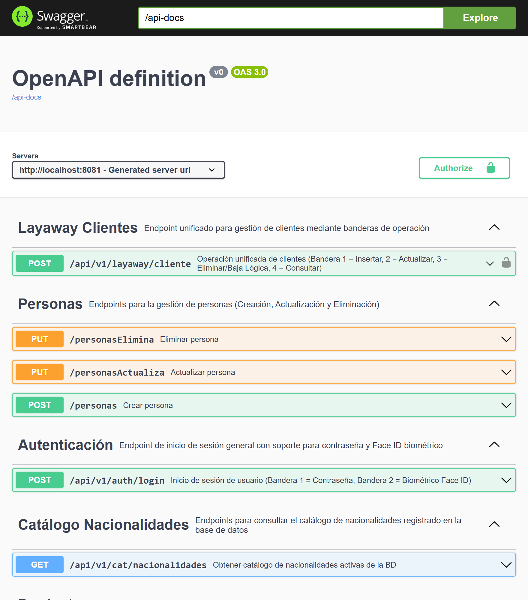

| Endpoint | Caso | Petición | Resultado | Captura |
|---|---|---|---|---|
| `POST /api/v1/layaway/cliente` | ✅ Éxito | Registro (`bandera: 1`) con datos válidos | **201** · cliente creado, cuenta de 12 dígitos, saldo 1000, `ACTIVA`; sin ID en la respuesta | [01](docs/evidencias/swagger/01_cliente_exito_201.png) |
| `POST /api/v1/layaway/cliente` | ❌ Error | Nombre de 2 letras, sexo `masculino`, CURP con mes 13, teléfono de 9 dígitos y contraseña débil | **400** · `codigo: 1` y el detalle de cada campo en `data` | [02](docs/evidencias/swagger/02_cliente_error_400.png) |
| `POST /api/v1/auth/login` | ✅ Éxito | Usuario y contraseña del cliente registrado | **200** · `token`, `tipoToken`, `expiraEnMinutos` y `rol` | [03](docs/evidencias/swagger/03_login_exito_200.png) |
| `POST /api/v1/auth/login` | ❌ Error | Contraseña incorrecta | **401** · `Credenciales inválidas.` | [04](docs/evidencias/swagger/04_login_error_401.png) |
| `GET /api/v1/cat/nacionalidades` | ✅ Éxito | Consulta del catálogo | **200** · nacionalidades activas | [05](docs/evidencias/swagger/05_catalogo_nacionalidades_exito_200.png) |
| `POST /api/v1/layaway/cliente` (bandera 4) | ✅ Éxito | Consulta por CURP con el token del **ejecutivo** | **200** · cliente con su cuenta, sin ID | [06](docs/evidencias/swagger/06_cliente_consulta_ejecutivo_exito_200.png) |
| `POST /api/v1/layaway/cliente` (bandera 4) | ❌ Error | La misma consulta **sin token** | **401** · `Se requiere autenticación…` | [07](docs/evidencias/swagger/07_cliente_consulta_sin_token_error_401.png) |
| `POST /api/v1/layaway/cliente` (bandera 4) | ❌ Error | Un **cliente** consulta la CURP de **otro** cliente | **404** · `No se encontró ningún cliente… entre los registros a los que tiene acceso.` | [08](docs/evidencias/swagger/08_cliente_consulta_registro_ajeno_error_404.png) |

**`POST /api/v1/layaway/cliente` — éxito (201)**

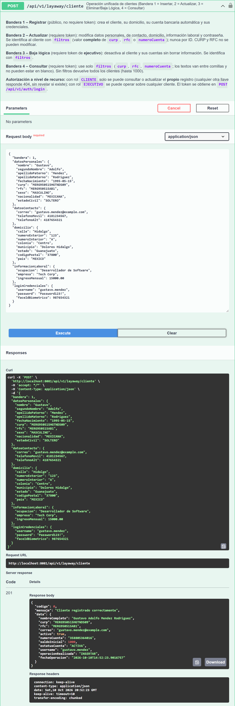

**`POST /api/v1/layaway/cliente` — error de validación (400)**

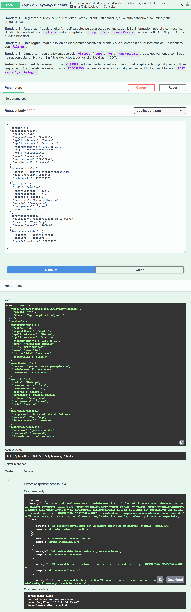

**`POST /api/v1/auth/login` — éxito (200)**

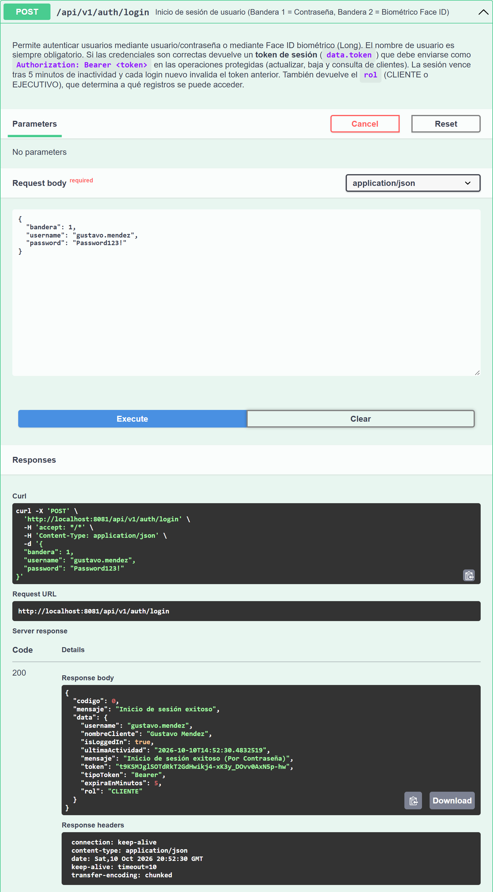

**`POST /api/v1/auth/login` — error de credenciales (401)**

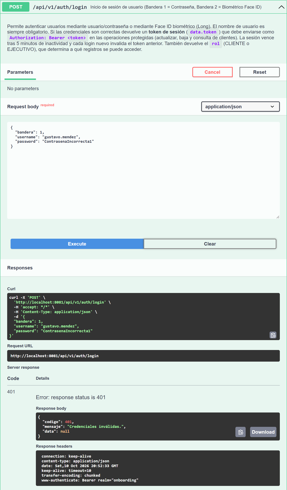

**`GET /api/v1/cat/nacionalidades` — éxito (200)**

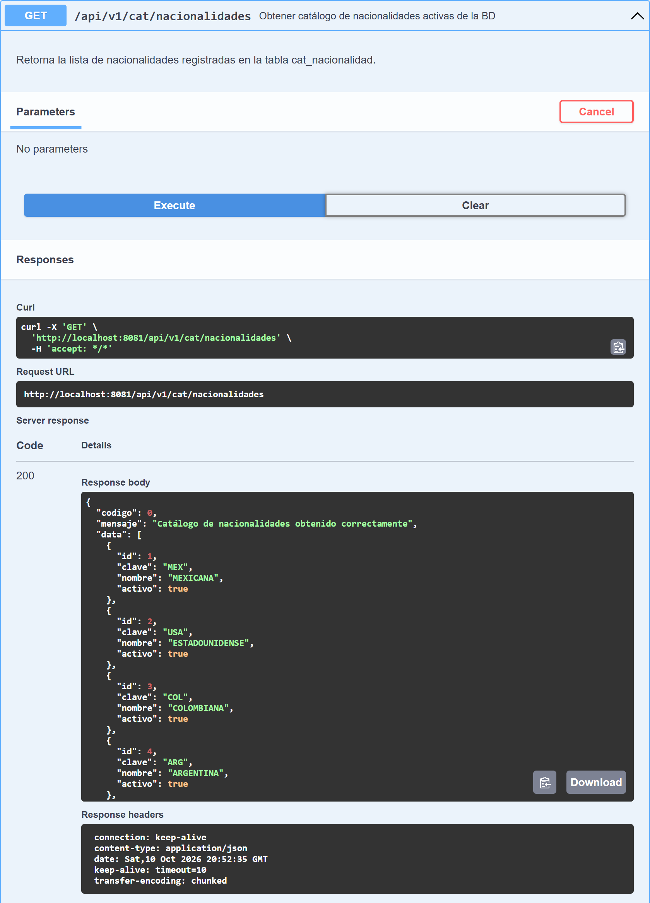

**Consulta autorizada por el ejecutivo (200)**

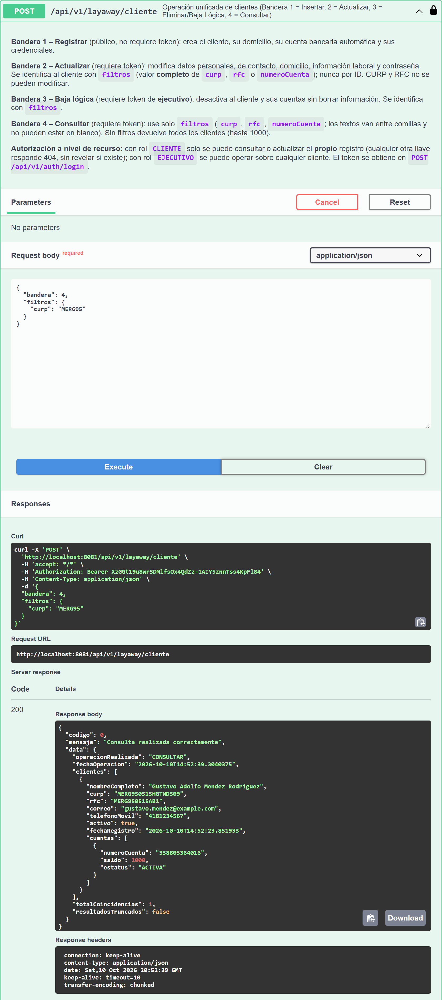

**Consulta sin token (401)**

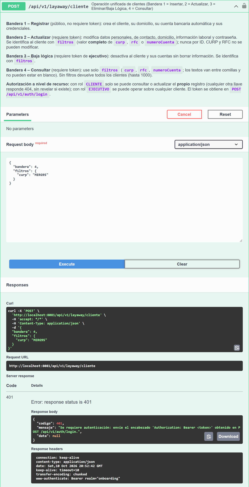

**Un cliente intenta ver el registro de otro (404)**

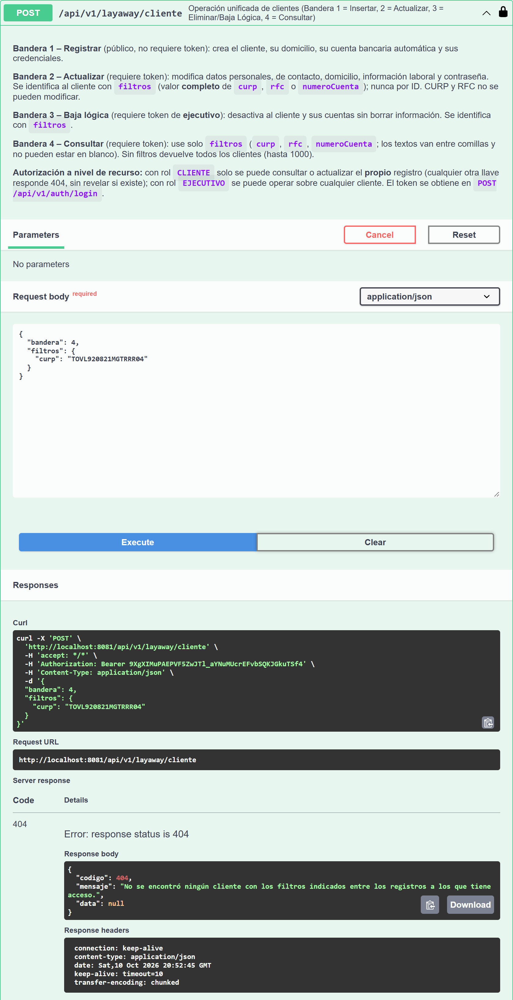

> El endpoint del catálogo solo consulta una tabla y no tiene un caso de error propio; los errores del servidor se manejan de forma centralizada (500/503) como se describe en la sección 7.

### 9.2 Pruebas unitarias — 249 de 249 exitosas

`.\gradlew.bat test` (JUnit 5 + Mockito):

| Clase | Pruebas | Qué valida |
|---|---|---|
| `DatosPersonalesDtoValidationTest` | 52 | Nombres (mínimo 3), catálogos estrictos de sexo y estado civil, formato de nacionalidad e intentos de inyección |
| `LoginCredencialesDtoPasswordTest` | 52 | Política de contraseña: 8 a 72 caracteres, 1 mayúscula, 1 minúscula, 1 número, 1 carácter especial, sin espacios |
| `FiltrosClienteDtoTest` | 37 | Llaves de la consulta: comillas, valores en blanco, comodines, longitud y campos no permitidos (incluido `clienteId`) |
| `ClienteLayawayServiceTest` | 23 | Reglas de negocio: alta, baja y actualización por llaves, consulta, cambio de contraseña, duplicados (`RegistroDuplicadoException`), registro inexistente (`ClienteNoEncontradoException`), cliente inactivo, **autenticación y autorización** |
| `LayawayClienteRequestValidacionTest` | 21 | Validación del DTO con `@Valid`: bandera, secciones obligatorias del registro, llaves completas en las banderas 2 y 3, solo `filtros` en la consulta, `clienteId`, mayoría de edad y detalle por campo |
| `SesionServiceTest` | 20 | Token vigente y renovación, encabezados ausentes o mal formados, token inexistente, vencido, sesión cerrada, cliente inactivo, solo se busca el hash |
| `GlobalExceptionHandlerTest` | 17 | Manejo centralizado: validación con `codigo: 1` antes de llegar al servicio, un caso por cada excepción de negocio (401, 403, 404, 409, 400, 423), 415, JSON roto y 500 sin exponer SQL ni clases |
| `AuthServiceTest` | 8 | Login por contraseña y Face ID, token de sesión (solo se guarda su hash), 401 uniforme, intentos fallidos, bloqueo |
| `LoginRequestValidacionTest` | 6 | `@LoginValido`: contraseña con la bandera 1, Face ID con la bandera 2, bandera y usuario |
| `PasswordEncoderUtilTest` | 3 | Sal aleatoria (hashes distintos), compatibilidad con hashes antiguos, hashes malformados |
| `ProductosServiceImplTest` | 10 | Módulo GestoPago (anexo) |

### 9.3 Pruebas de seguridad, validación, concurrencia y carga — 177 de 177 exitosas

Script reproducible (solo librería estándar de Python): [`docs/evidencias/pruebas_seguridad_carga.py`](docs/evidencias/pruebas_seguridad_carga.py) · resultado completo: [`docs/evidencias/resultado_pruebas_seguridad_carga.txt`](docs/evidencias/resultado_pruebas_seguridad_carga.txt)

| Categoría | Casos | Ejemplos |
|---|---|---|
| Registro y validaciones del documento | 85 | Nombres de 2/3/51 letras, CURP/RFC con mes 13 o día 32, correo sin dominio, fecha `1995-02-31`, menor de edad por un día, teléfonos de 9/11 dígitos o como texto, código postal inválido, ingreso `0.00`, negativo o `1e999999999`, catálogos con variantes, **política de contraseña** (sin mayúscula, minúscula, número, símbolo, corta, con espacio) |
| Unicidad y política de contraseña | 21 | CURP, RFC, correo (incluso en mayúsculas) y username duplicados; contraseñas que no cumplen la política y contraseñas válidas en el límite (8 y 72 caracteres) |
| Bandera / JSON | 15 | Bandera como texto o decimal, JSON roto o anidado 5,000 niveles, cuerpo de 200 KB, cuerpo *chunked* de 2 MB, `Content-Type` incorrecto |
| Actualizar por llaves | 20 | Por CURP, RFC y número de cuenta; intento de cambiar CURP o RFC; sin llaves, llave incompleta, llave inexistente, filtro que no es llave, `clienteId` rechazado; llaves de clientes distintos; robar el correo de otro cliente |
| Editar contraseña | 10 | Política aplicada al editar, usuario distinto rechazado, la contraseña nueva funciona y la vieja deja de servir |
| Baja lógica por llaves | 8 | Sin llaves, `clienteId` rechazado, llave incompleta o inexistente, baja por CURP, baja repetida, actualizar un cliente dado de baja; la respuesta no trae el ID |
| Login | 15 | Contraseña por defecto, fuerza bruta (bloqueo al 5.º intento), enumeración por código y por **tiempo** (51 ms contra 51 ms) |
| Concurrencia y carga | 3 | 30 altas simultáneas con la misma CURP (1 creada, 29 rechazadas con 409); **600 altas con 100 hilos: 0 errores (134 altas/s)**; 400 logins concurrentes |

### 9.4 Autenticación y autorización a nivel de recurso — 54 de 54 exitosas

Script: [`docs/evidencias/pruebas_autorizacion.py`](docs/evidencias/pruebas_autorizacion.py) · resultado: [`docs/evidencias/resultado_pruebas_autorizacion.txt`](docs/evidencias/resultado_pruebas_autorizacion.txt). Dos clientes (Alicia y Beto) y un ejecutivo contra PostgreSQL:

| Escenario | Resultado |
|---|---|
| Banderas 2, 3 y 4 sin token, con token inventado, corto, con comillas o `<script>`, con esquema Basic o `Bearer` vacío | **401** y `WWW-Authenticate: Bearer` |
| Alicia consulta **sin filtros** | Solo ve su propio registro (no la lista completa) |
| Alicia consulta la CURP, el RFC, la cuenta o un fragmento de la CURP de Beto | **404**, con el mismo mensaje que un registro que no existe |
| Alicia intenta **actualizar** o **cambiar la contraseña** de Beto | **404**; se comprobó después que los datos de Beto no cambiaron y que él sigue entrando con su contraseña |
| Alicia intenta la baja (propia o de Beto) | **403** (solo ejecutivos) |
| Alicia cambia su contraseña | Su token anterior deja de servir (401) y entra con la nueva |
| El ejecutivo consulta, actualiza y da de baja a Beto | **200**; tras la baja el token de Beto da 401 y su login da 403 |
| Errores de validación (cuerpo inválido, llave incompleta) | **400** con `codigo: 1`, `Datos no validos{…}` y el campo que lo provoca en `data` |
| Actualizar a un cliente dado de baja | **403** con `codigo: 403` |
| JSON roto, `Content-Type` y método incorrectos, ruta inexistente | `codigo` = estado HTTP y `{codigo, mensaje, data}` |
| Respuestas del alta, login, consulta y baja | Ninguna incluye el ID del cliente |

La expiración del token (5 minutos) se verificó además con datos reales: con `token_expira` en el pasado la petición responde 401 y la sesión queda cerrada; en la base solo existe el hash del token (64 caracteres), nunca el token en claro.

También se verificó el servicio contra una instancia publicada con [`docs/evidencias/pruebas_publicado.py`](docs/evidencias/pruebas_publicado.py) (25 casos; con `EJECUTIVO_USUARIO`/`EJECUTIVO_PASSWORD` prueba además la baja).

### 9.5 Reglas en la base de datos — 12 de 12

La base rechaza por sí misma los datos inválidos aunque se manipule por SQL directo (sexo en minúsculas, nacionalidad fuera del catálogo, menor de edad, saldo negativo, borrado físico, reactivar la cuenta de un cliente dado de baja…). Detalle: [`docs/evidencias/pruebas_reglas_base_de_datos.txt`](docs/evidencias/pruebas_reglas_base_de_datos.txt)

---

## 10. Estructura del código fuente

```
src/main/java/com/proyecto/servicios/
├── controller/onboarding/
│   ├── ClienteLayawayController.java   # POST /api/v1/layaway/cliente (banderas 1, 2, 3, 4)
│   ├── AuthController.java             # POST /api/v1/auth/login
│   └── CatNacionalidadController.java  # GET  /api/v1/cat/nacionalidades
├── service/onboarding/
│   ├── ClienteLayawayService.java      # Lógica de negocio: alta + cuenta automática, actualización, baja lógica, consulta; autorización por recurso
│   ├── AuthService.java                # Login (emite el token), bloqueo por intentos, expiración de sesión
│   ├── SesionService.java              # Autenticación de cada petición protegida por token (Bearer)
│   └── CatNacionalidadService.java     # Catálogo de nacionalidades convertido a DTO
├── entity/onboarding/                  # Entidades JPA: Cliente, Domicilio, Cuenta, UsuarioLogin, CatNacionalidad
├── repositorys/onboarding/             # Repositorios Spring Data JPA (incluye las consultas solicitadas)
├── dto/onboarding/                     # DTO de petición/respuesta con Bean Validation (incluye CatNacionalidadResponse)
├── validation/                         # @MayorDeEdad, @DosDecimales, @OperacionClienteValida, @LoginValido, deserializadores estrictos
├── exception/                          # OnboardingException y sus 9 excepciones de negocio + GlobalExceptionHandler (manejo centralizado)
└── config/                             # Pool de BD, Flyway, Jackson estricto, límite de tamaño, PasswordEncoderUtil, TokenUtil, usuario ejecutivo inicial, esquema de seguridad de Swagger
src/main/resources/db/migration/        # Migraciones Flyway (V3, V8, V9 y V10 para onboarding)
src/test/java/                          # Pruebas unitarias
docs/
├── base_de_datos/                      # Script de creación y diagrama ER
├── evidencias/                         # Resultados y scripts de prueba
└── Documento_Tecnico_Onboarding.docx   # Documento técnico
```

---

# Anexo: Integración de Productos GestoPago

> Documentación del módulo de productos previo al proyecto de onboarding; se conserva sin cambios.

## 1. Objetivo
El objetivo de esta integración es consumir el servicio externo de GestoPago para obtener el catálogo de productos disponibles (`GET /sistema/service/getProductList.do`), procesar la respuesta en formato XML a través de Jackson XML, mapearla a nuestro DTO interno (`ProductoResponse`) y exponerla a los clientes de nuestra plataforma mediante el endpoint `GET /productos` envuelta en un formato estandarizado `GenericResponse`.

---

## 2. Endpoints y Configuración

### Endpoints
- **Endpoint Interno Lista Plana (Filtro opcional)**: `GET /productos` o `GET /productos?tipoFront=1`
- **Endpoint Interno Agrupado por tipoFront**: `GET /productos/agrupados`
- **Endpoint Externo (Proveedor)**: `GET /sistema/service/getProductList.do`
- **Endpoint Autenticación Proveedor**: `POST /sistema/app/jwt-gp/authenticate/`
- **URL Base Proveedor**: `https://gestopago.portalventas.net`

### Propiedades de Configuración (`application.properties`)
```properties
# Base URL GestoPago
gestopago.base-url=https://gestopago.portalventas.net

# Autenticación GestoPago
gestopago.auth.id-distribuidor=YOUR_DISTRIBUIDOR_ID
gestopago.auth.codigo-dispositivo=YOUR_DEVICE_CODE
gestopago.auth.password=YOUR_PASSWORD
gestopago.auth.refresh-rate-ms=3600000

# Endpoint y Timeouts de Productos
gestopago.productos.endpoint=/sistema/service/getProductList.do
gestopago.productos.connect-timeout=5000
gestopago.productos.read-timeout=10000
```

---

## 3. Flujo de Autenticación, Almacenamiento y Renovación de Token

1. **Obtención de Token**: El cliente de autenticación `GestoPagoAuthClient` solicita el JWT invocando `POST /sistema/app/jwt-gp/authenticate/` con `idDistribuidor`, `codigoDispositivo` y `password`.
2. **Persistencia y Actualización**: `GestoPagoTokenServiceImpl` guarda o actualiza la entidad `GestoPagoToken` mediante `GestoPagoTokenRepository` y `GestoPagoTokenMapper`.
3. **Mantenimiento Programado**: Se ejecuta `@Scheduled(fixedRateString = "${gestopago.auth.refresh-rate-ms:3600000}")` para renovar el token proactivamente cada hora.
4. **Renovación On-Demand**: Cuando `ProductosServiceImpl` consulta el token activo a `GestoPagoTokenService` y no existe uno presente, invoca automáticamente `tokenService.renovarToken()` antes de realizar la petición HTTP externa.
5. **Formato Header**: La petición externa incluye `Authorization: Bearer <token>`. Si el atributo `token_type` del proveedor viene vacío o nulo, se utiliza `"Bearer"` como valor predeterminado.

---

## 4. Estructura de Capas y Arquitectura

```
src/main/java/com/proyecto/servicios/
├── client/
│   ├── GestoPagoAuthClient.java       # Cliente Feign para autenticación
│   └── ProductosClient.java           # Cliente Feign para obtención de productos
├── config/
│   ├── ConfigDB.java                  # Configuración de base de datos
│   ├── FlywayConfig.java              # Configuración de migraciones DB
│   ├── OpenApi.java                   # Configuración OpenAPI / Swagger
│   └── ProductosFeignConfig.java      # Configuración de timeouts de Feign
├── controller/
│   └── ProductosController.java       # Endpoint REST GET /productos
├── entity/gestopago/
│   └── GestoPagoToken.java            # Entidad JPA para tokens
├── enums/
│   └── ErrorCode.java                 # Enum estandarizado de errores
├── exception/
│   ├── IntegrationException.java      # Excepción personalizada de integración
│   └── GlobalExceptionHandler.java    # Controlador global de excepciones @RestControllerAdvice
├── model/
│   ├── GenericResponse.java           # Envoltorio genérico para respuestas API
│   ├── gestopago/
│   │   └── GestoPagoAuthResponse.java # DTO respuesta de autenticación
│   └── productos/
│       ├── MensajeXml.java            # Jackson XML element <MENSAJE>
│       ├── ProductoXml.java           # Jackson XML element <producto>
│       ├── ProductosXml.java          # Jackson XML container <PRODUCTOS>
│       ├── ProductosXmlResponse.java  # Jackson XML root <RESPONSE>
│       └── ProductoResponse.java      # DTO interno expuesto por la API
├── repositorys/gestopago/
│   └── GestoPagoTokenRepository.java  # Repositorio Spring Data JPA
└── service/
    ├── GestoPagoTokenService.java     # Interfaz gestión de tokens
    ├── ProductosService.java          # Interfaz gestión de productos
    └── Impl/
        ├── GestoPagoTokenServiceImpl.java # Implementación servicio tokens
        └── ProductosServiceImpl.java     # Implementación servicio productos
```

---

## 5. Transformaciones de Modelos (XML a DTO Interno)

1. **Modelos Externos XML**: Jackson XML deserializa la respuesta del proveedor en la jerarquía:
   - `<RESPONSE>` -> `ProductosXmlResponse`
   - `<MENSAJE>` -> `MensajeXml`
   - `<PRODUCTOS><producto ... /></PRODUCTOS>` -> `ProductosXml` y `ProductoXml`.
2. **Modelo Interno JSON**: `ProductosServiceImpl` transforma cada `ProductoXml` a `ProductoResponse`, omitiendo envoltorios externos como `<RESPONSE>`, `<MENSAJE>`, `<CODIGO>` o `<TEXTO>` del proveedor.

---

## 6. Respuestas y Códigos de Error (`ErrorCode`)

### Respuesta Exitosa (`codigo: 0`)
La API interna responde **exclusivamente con HTTP 200 y código 0**:
```json
{
  "codigo": 0,
  "mensaje": "Productos obtenidos correctamente",
  "data": [
    {
      "servicio": "Recarga",
      "producto": "Telcel $100",
      "idServicio": "1",
      "idProducto": "100",
      "idCatTipoServicio": "2",
      "tipoFront": "S",
      "hasDigitoVerificador": false,
      "precio": "100.0",
      "showAyuda": false,
      "tipoReferencia": "NUMERO",
      "legend": "Ingresa tu número"
    }
  ]
}
```

### Tabla de Códigos `ErrorCode`
| Código | Name | Descripción | HTTP Status MAPEADO |
|---|---|---|---|
| **0** | `SUCCESS` | Operación exitosa (reservado solo para éxito) | 200 OK |
| **1** | `AUTHENTICATION_ERROR` | Error de autenticación (HTTP 401, 403 o token nulo/inválido) | 401 UNAUTHORIZED |
| **2** | `HTTP_ERROR` | Respuesta no exitosa del servicio externo (ej. HTTP 500) | 502 BAD GATEWAY |
| **3** | `TIMEOUT_ERROR` | Tiempo de espera agotado (Timeout en conexión o lectura) | 504 GATEWAY TIMEOUT |
| **4** | `COMMUNICATION_ERROR` | Error de comunicación o red | 502 BAD GATEWAY |
| **5** | `INVALID_RESPONSE` | Respuesta nula, incompleta o sin mensaje válido | 502 BAD GATEWAY |
| **6** | `CONFIGURATION_ERROR` | Error de configuración o credenciales faltantes | 500 INTERNAL SERVER ERROR |
| **7** | `INTERNAL_ERROR` | Error interno del sistema | 500 INTERNAL SERVER ERROR |

---

## 7. Estrategia de Logs y Seguridad

### Información NO registrada en logs (Protección de Datos Sensibles)
- Passwords de usuario/sistema.
- Tokens JWT completos.
- Cabeceras de autorización `Authorization: Bearer ...`.
- Cuerpos completos de respuestas sensibles.

### Información SI registrada en logs
- Inicio y fin de la consulta de productos.
- Cantidad total de productos obtenidos.
- Status HTTP en caso de errores de comunicación o integración.
- Clasificación limpia del error sin exponer datos confidenciales.

---

## 8. Cobertura de Pruebas Unitarias

Se implementó la suite de pruebas `ProductosServiceImplTest` en `src/test/java/com/proyecto/servicios/service/ProductosServiceImplTest.java` utilizando `@ExtendWith(MockitoExtension.class)` y JUnit 5, cubriendo 10 escenarios obligatorios:

1. **Consulta exitosa con token existente**: Verifica deserialización, transformación y envío de header `Bearer token-prueba`.
2. **Renovación cuando no existe token**: Verifica `verify(tokenService).renovarToken()` y re-consulta exitosa del token.
3. **Error de autenticación HTTP 401**: Verifica lanzamiento de `IntegrationException` con `ErrorCode.AUTHENTICATION_ERROR`.
4. **Error de autenticación HTTP 403**: Verifica `AUTHENTICATION_ERROR`.
5. **Error HTTP 500**: Verifica `ErrorCode.HTTP_ERROR`.
6. **Timeout**: Simulación con `FeignException.GatewayTimeout` y `SocketTimeoutException` validando `ErrorCode.TIMEOUT_ERROR`.
7. **Respuesta null**: Verifica `ErrorCode.INVALID_RESPONSE`.
8. **Respuesta sin mensaje**: Verifica `ErrorCode.INVALID_RESPONSE`.
9. **Token vacío o no disponible**: Verifica `AUTHENTICATION_ERROR` y `verifyNoInteractions(productosClient)`.
10. **Validación de DTO `ProductoResponse`**: Comprobación exhaustiva de `equals`, `hashCode`, `toString`, `assertAll`, `assertTrue` y `assertFalse`.

---

## 9. Comandos de Verificación y Redis

Para iniciar y gestionar la caché de Redis local, consulta [INICIALIZAR_REDIS.md](file:///d:/INGENIERIA_UTNG/10mo/unidad%201/prueba/prueba/INICIALIZAR_REDIS.md).

Para ejecutar la compilación, pruebas unitarias y arranque del proyecto:

```powershell
# 1. Limpieza y compilación Java
.\gradlew.bat clean compileJava

# 2. Ejecución de suite completa de pruebas unitarias
.\gradlew.bat clean test

# 3. Iniciar la aplicación Spring Boot
.\gradlew.bat bootRun
```
