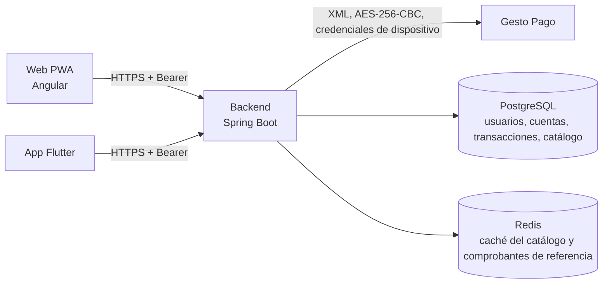

# Documento Técnico - Plataforma de Pagos de Servicios

Estado documentado: **2026-11-14**, con los cinco módulos construidos en backend, web y móvil. Todo lo descrito se comprobó leyendo el código; lo que no se pudo demostrar en el ambiente de pruebas se dice de forma explícita (secciones 8 y 9). Los valores secretos se indican con marcadores `<...>`.

## 1. Resumen y alcance

La plataforma permite a un cliente iniciar sesión, consultar el catálogo de servicios de Gesto Pago, validar una referencia, pagar un servicio y consultar su historial, desde dos clientes:

- **Web PWA** (Angular, carpeta `web/`).
- **App móvil** (Flutter, carpeta `mobile/`).
- **Backend** (Spring Boot, raíz del repositorio): concentra la lógica y es el único que habla con Gesto Pago.

Los cinco módulos existen en las tres partes:

| # | Módulo | Backend | Web | Móvil |
|---|---|---|---|---|
| 1 | Login, logout y sesión | Sí | Sí | Sí |
| 2 | Catálogo con `logoUrl`, `ayudaUrl` y `categoria` | Sí | Sí | Sí |
| 3 | Validación de referencia con comprobante de un solo uso (candado en servidor) | Sí | Sí | Sí |
| 4 | Pago: resumen, confirmación con PIN, idempotencia, estados Exitoso / Rechazado / Pendiente, folio o número de operación y `confirmTx` | Sí | Sí | Sí |
| 5 | Historial y detalle | Sí | Sí | Sí |

Alcance de la verificación (detalle en la sección 9):

- Pruebas automatizadas al 2026-11-14: backend 767, web 191, móvil 178; todas pasan. `flutter analyze` sin avisos; los builds de producción de la web y de Flutter web son correctos.
- Prueba manual con un cliente de prueba local: login, catálogo real, validación de referencia (solo formato), flujo de pago completo e historial en ambas plataformas.
- **No se ha observado un pago exitoso con folio ni un pago pendiente desde las apps nuevas.** Los dos pagos de prueba fueron rechazados por Gesto Pago (sección 8).
- Android: proyecto configurado, pero sin APK ni prueba en emulador.

Dirección visual común, "el recibo": tinta índigo `#2B2F77`, tipografías Sofia Sans y Sofia Sans Condensed, catálogo como directorio en renglones y comprobante como ticket perforado con sello PAGADO / PENDIENTE / NO APLICADO.

## 2. Arquitectura general



### 2.1 Decisión: los clientes NO consumen Gesto Pago directamente

Web y Flutter consumen solo este backend, que consulta Gesto Pago. Motivo:

- Gesto Pago se autentica **por dispositivo** (`idDistribuidor`, `codigoDispositivo`, password), no por usuario.
- Las peticiones `verifyReference`, `sendTx` y `confirmTx` van firmadas/cifradas con **AES-256-CBC** (llave e IV secretos).
- No ofrece usuarios ni historial: ambos salen de la base de datos propia.
- Exponer esas credenciales y llaves en un navegador o APK violaría la regla de **cero secretos en el cliente**.

Comprobado en código: el backend toma las credenciales de variables de entorno (`GESTOPAGO_ID_DISTRIBUIDOR`, `GESTOPAGO_CODIGO_DISPOSITIVO`, `GESTOPAGO_PASSWORD`, `GESTOPAGO_SECRET_KEY`, `GESTOPAGO_IV`), y los clientes solo conocen la URL del backend (`apiBaseUrl` en web, `API_BASE_URL` en Flutter). La única excepción de red hacia el dominio de Gesto Pago son las **imágenes** (logotipos y ayuda de referencia), cuyas URLs entrega el backend (ver 4.8 y 8).

## 3. Arquitectura por capas de cada cliente

Ambos clientes siguen la misma organización por feature con capas data / domain / presentation.

### 3.1 Web (`web/src/app`)

```
core/
  config/        app-config.ts (token API_BASE_URL desde environment)
  http/          api-client.ts, result.ts, idempotency.ts
  interceptors/  auth.interceptor.ts, no-autorizado.interceptor.ts
  guards/        auth.guard.ts (authGuard, soloPublicoGuard)
  session/       session-store.ts
  error/         mensajes-error.ts
features/
  auth/          data (api, dto, repository-impl) · domain (models, repository, use-cases login/logout)
                 presentation (pages login-page, components validadores-login, store auth.store)
  catalogo/      data (api, dto, repository-impl) · domain (models producto/producto-reglas, repository, use-case obtener-catalogo)
                 presentation (pages catalogo-page y producto-detalle-page; components catalogo-filtros, logo-servicio, servicio-card; store catalogo.store)
  referencia/    data (api, dto, repository-impl) · domain (models formato/mensajes/validacion, repository, use-case validar-referencia)
                 presentation (page referencia-page, component resultado-referencia, guard validacion-vigente, store validacion-referencia)
  pago/          data (api, dto, mapeo/interpretar-respuesta, repository-impl) · domain (models pago/pago-reglas/mensajes-pago, repository, use-cases)
                 presentation (page pago-page; components captura-datos, resumen-pago, modal-confirmacion, resultado-pago, comprobante-pago;
                 guards pago-permitido y pago-salida; store pago.store)
  historial/     data (api, dto, repository-impl) · domain (models historial/historial-reglas/mensajes-historial, repository, use-cases)
                 presentation (pages historial-page y detalle-pago-page; components fila-pago, historial-filtros; stores historial y detalle-historial)
shared/ui/       cabecera, icono, pasos
```

Rutas (`app.routes.ts`): `/login`, `/catalogo`, `/catalogo/:idServicio/:idProducto`, `.../referencia`, `.../pago`, `/historial`, `/historial/:upc`. `/inicio` y la raíz redirigen a `/catalogo`. Todas, salvo `/login`, pasan por `authGuard`; `/pago` además por `pagoPermitidoGuard` y `pagoSalidaGuard`.

### 3.2 Flutter (`mobile/lib`)

```
core/
  config/        app_config.dart, app_theme.dart (Sofia Sans vía google_fonts)
  http/          api_client.dart, api_providers.dart, idempotency.dart, json_helpers.dart, result.dart
  interceptors/  auth_interceptor.dart, sesion_interceptor.dart
  router/        app_router.dart (go_router)
  session/       almacen_sesion(.dart/_seguro.dart), session_controller.dart, session_state.dart, rol_usuario.dart
  error/         mensajes_error.dart
features/
  auth/          data · domain (usecases iniciar/cerrar sesión) · presentation (login_screen, login_controller, boton_cerrar_sesion, validadores_login)
  catalogo/      data · domain (entity, usecase obtener_catalogo, utils filtros/formato) · presentation (catalogo_screen, detalle_producto_screen, widgets)
  referencia/    data · domain (usecase validar_referencia, utils formato_referencia y guard_pago) · presentation (referencia_screen, tarjeta_resultado_referencia, textos)
  pago/          data · domain (entities, usecases, utils interpretar_respuesta y reglas_pago) · presentation (pago_screen, comprobante_screen, pago_notifier, widgets captura/resumen/PIN/resultado/comprobante, textos_pago)
  historial/     data · domain (usecase, utils reglas_historial) · presentation (historial_screen, detalle_historial_screen, notifiers, fila_pago, textos)
shared/widgets/  app_scaffold, banner_mensaje, contenedor_ancho, ficha_datos, indicador_pasos, pagina_flujo, pantalla_error_configuracion, perforado, ticket_recibo
```

Rutas (`app_router.dart`): `/login`, `/catalogo`, `/catalogo/:idServicio/:idProducto`, `.../referencia`, `.../pago` (con redirección-candado), `/historial`, `/historial/:upc`.

### 3.3 Responsabilidad de cada capa

| Capa | Responsabilidad |
|---|---|
| `core` | Piezas transversales: configuración, cliente HTTP, interceptores, sesión, rutas/guardas, mensajes de error. |
| `data` | DTO/modelos del JSON del backend, fuente remota (llamadas HTTP) e implementación del repositorio. |
| `domain` | Modelos/entidades puros, reglas, contrato del repositorio y casos de uso. |
| `presentation` | Páginas/pantallas, componentes/widgets y estado (store con Signals en Web, providers/notifiers Riverpod en Flutter). |
| `shared` | Componentes de UI reutilizables. |

### 3.4 Equivalencias Web <-> Flutter

| Concepto | Web (Angular) | Flutter |
|---|---|---|
| Cliente HTTP | `ApiClient` (HttpClient) | `ApiClient` (Dio) |
| Resultado | `Result<T>` = `Ok<T> \| Failure` | `Result<T>` sellado: `Ok<T>` / `Failure` |
| Interceptor de token | `authInterceptor` | `AuthInterceptor` |
| Interceptor de 401 | `noAutorizadoInterceptor` | `SesionInterceptor` |
| Estado de sesión | `SessionStore` (Signals) | `SessionController` (Riverpod Notifier) |
| Almacenamiento del token | Solo memoria | `flutter_secure_storage` en Android; solo memoria al compilar para web |
| Rutas y protección | `app.routes.ts` + `authGuard` / `soloPublicoGuard` / `pagoPermitidoGuard` | `app_router.dart` con `redirect` |
| Candado hacia el pago | `pagoPermitidoGuard` + `validacionVigenteGuard` | `pagoPermitido(...)` en el `redirect` de `/pago` |
| Interpretación del pago | `interpretar-respuesta.ts` | `interpretar_respuesta.dart` (misma tabla) |
| Estado del pago | `PagoStore` | `PagoNotifier` |
| URL del backend | `environment*.ts` (compilación) | `--dart-define=API_BASE_URL` |
| Clave de idempotencia | `nuevaIdempotencyKey()` (`crypto.randomUUID`) | `idempotency.dart` (UUID v4) |
| Sondeo de pago pendiente | 10, 20, 35, 50, 70, 90 y 120 s | Los mismos intervalos |
| Timeout del pago | 75 s (`TIMEOUT_PAGO_MS`) | 75 s (`kTiempoEsperaPago`) |
| Tipografía | Sofia Sans desde Google Fonts (`index.html`) | Sofia Sans vía `google_fonts` |

## 4. Seguridad y sesiones

Solo lo que el código hace hoy.

### 4.1 Token de sesión
- El backend entrega un token opaco en `POST /api/v1/auth/login` (`data.token`, `tipoToken`, `expiraEnMinutos`, `rol`). Cada login nuevo **invalida la sesión anterior del mismo usuario** (sesión única): iniciar sesión en una plataforma cierra la otra.
- **Web:** el token vive solo en memoria (`SessionStore`, Signals). No se escribe en localStorage, sessionStorage, IndexedDB ni cookies. **Recargar la página cierra la sesión.**
- **Flutter en Android:** se guarda en `flutter_secure_storage` (Keystore, `encryptedSharedPreferences`) junto con usuario, nombre, rol y marca de última actividad; se restaura al abrir la app si no expiró.
- **Flutter compilado para web:** `crearAlmacenSesion` usa un almacén en memoria (`kIsWeb`); el token no se persiste.

### 4.2 Expiración por inactividad
- Backend: la sesión vence tras 5 minutos de inactividad.
- Web: temporizador de 5 min (`INACTIVIDAD_MS`) que se reinicia tras cada petición autenticada exitosa; al vencer, cierra la sesión local y redirige a `/login` con el aviso "Tu sesión expiró por inactividad".
- Flutter: mismo criterio (`AppConfig.inactividadMaxima`); además revisa al volver de segundo plano (`alVolverDeSegundoPlano`). No hay refresh token.

### 4.3 Manejo del 401 y del 403 de cuenta inactiva
Un 401 en una petición autenticada limpia la sesión local y redirige a `/login` con el aviso "Tu sesión ya no es válida. Inicia sesión de nuevo.", sin reintentar. En logout un 401 se trata como éxito (Web: sin aviso). El login queda fuera porque no lleva `Authorization`. Un 403 con motivo de cliente inactivo cierra la sesión con el aviso "Tu cuenta está inactiva. Comunícate con tu ejecutivo para reactivarla."

### 4.4 Logout
`POST /api/v1/auth/logout` con Bearer; el token deja de servir de inmediato. Ambos clientes tienen caso de uso de cierre de sesión que además limpia el estado local (Flutter, también el almacenamiento seguro).

### 4.5 Envío del token
- Web: `Authorization: Bearer` solo se agrega a URLs que empiezan por `apiBaseUrl` y solo si hay sesión.
- Flutter: se agrega cuando hay token y la petición no está marcada como no autenticada.
- `GET /productos` (catálogo) es público: los clientes lo llaman sin token.

### 4.6 CORS y filtros del backend
- Lista exacta de orígenes en `app.cors.allowed-origins` (variable `APP_CORS_ORIGINS`, por defecto `http://localhost:4200,http://localhost:5000`); nunca `*`. El puerto 5000 es el de la app Flutter compilada para web.
- Métodos GET, POST, OPTIONS. Headers permitidos: `Authorization`, `Content-Type`, `Idempotency-Key`. Expuestos: `Retry-After`, `WWW-Authenticate`. Sin credenciales; `maxAge` 600 s.
- El filtro CORS tiene la mayor precedencia: el preflight se responde sin token y antes de los demás filtros.
- Otros filtros: cabeceras de seguridad, límite de tamaño de cuerpo (64 KB, 413) y límite de intentos de login (10 por minuto por IP, 429 con `Retry-After`).
- Login: 5 intentos fallidos consecutivos bloquean la cuenta 15 minutos (423).

### 4.7 Variables de entorno y configuración
- Backend (marcadores, nunca valores): `DB_PASSWORD=<...>` (`DB_URL`, `DB_USERNAME` opcionales), `GESTOPAGO_ID_DISTRIBUIDOR=<...>`, `GESTOPAGO_CODIGO_DISPOSITIVO=<...>`, `GESTOPAGO_PASSWORD=<...>`, `GESTOPAGO_SECRET_KEY=<...>`, `GESTOPAGO_IV=<...>`, `APP_CORS_ORIGINS=<orígenes separados por coma>`, `REDIS_HOST` / `REDIS_PORT`, `SWAGGER_ENABLED`, `PORT` (por defecto 8081). `application.properties` importa de forma opcional un archivo `secretos.properties` local.
- Web: la URL del backend se fija en compilación en `src/environments/`. En producción `environment.ts` trae un marcador `.invalid` que **debe reemplazarse** antes de desplegar. Sin secretos en esos archivos.
- Flutter: `API_BASE_URL` obligatoria vía `--dart-define`; sin ella la app muestra la pantalla de error de configuración.

### 4.8 Service worker (PWA)
`web/ngsw-config.json` define:
- `assetGroups`: app shell y estáticos.
- `dataGroups` con un solo grupo, `logotipos`: URLs `https://gestopago.portalventas.net/sistema/images/**`, estrategia `performance`, 100 entradas máximo, 7 días.

Ninguna respuesta del API del backend se guarda en Cache Storage; solo se cachean las imágenes de Gesto Pago. Nota: el `README.md` de `web/` todavía dice lo contrario ("no define `dataGroups`") y describe solo el Sprint 0; está desactualizado.

### 4.9 PIN de pago (segundo factor)
- Cada pago exige el PIN de 4 dígitos (`twoFA`). El backend lo guarda con PBKDF2; tras 3 intentos fallidos lo bloquea 15 minutos (423, motivo `PIN_BLOQUEADO`).
- El PIN no se guarda en el cliente: se captura en el modal de confirmación (web, "Confirma tu pago") o en el diálogo del mismo nombre (móvil) y viaja solo en la petición de pago.

### 4.10 Candado de referencia
- `POST /api/v1/pagos/referencia/validar` devuelve, cuando `puedePagar` es verdadero, un comprobante `idValidacion` (UUID v4) guardado en Redis con vigencia de 300 s (`pagos.referencia.validacion-ttl-segundos`).
- El pago con referencia debe enviar ese `idValidacion`. El servidor lo consume con `GETDEL` (atómico, un solo uso) y valida que corresponda a esa referencia. Sin él, vencido o usado, responde **428** (`VALIDACION_REQUERIDA`). El comprobante se consume aunque el pago termine rechazado: hay que validar de nuevo.
- Si Redis no responde, falla cerrado (503). Por eso Redis es **necesario** para pagar con referencia.
- En los clientes, el botón "Continuar al pago" está deshabilitado mientras no haya una validación vigente, y las rutas de pago redirigen a la captura de referencia si no la hay.

### 4.11 Idempotencia
- El cliente genera un UUID nuevo por cada intento de pago y lo envía en `Idempotency-Key`. Reenviar la misma solicitud con la misma llave no cobra de nuevo: devuelve el resultado registrado. La misma llave con otros datos responde 409 (`LLAVE_OTROS_DATOS`); en uso simultáneo, 409 (`LLAVE_EN_USO`).
- Los clientes conservan la llave mientras el pago está pendiente y consultan el resultado con `POST /api/v1/pagos/estado` (por `idempotencyKey` o `upc`), sin repetir el cobro.
- El backend fija siempre el monto: precio del catálogo (`PRECIO_FIJO`), adeudo informado por el proveedor (`ADEUDO`) o importe capturado por el usuario cuando no hay consulta en línea (`CAPTURADO`).

### 4.12 Token de Gesto Pago
El backend autentica ante Gesto Pago con `POST /sistema/app/jwt-gp/authenticate/` y reutiliza el token guardado en PostgreSQL mientras esté vigente (detalle y regla de uso en la sección 8).

## 5. Catálogo de servicios consumidos

Estado por módulo. "Gesto Pago detrás" es el endpoint al que el backend llama (host `https://gestopago.portalventas.net`, respuestas XML). Todos los endpoints del backend usan el envoltorio de la sección 6; salvo el login y el catálogo, requieren `Authorization: Bearer` de un usuario CLIENTE.

| Módulo | Endpoint del backend | Gesto Pago detrás | Estado |
|---|---|---|---|
| 1. Login | `POST /api/v1/auth/login` (cuerpo: `bandera: 1`, `username`, `password`) | Ninguno (usuarios propios en PostgreSQL) | Implementado y probado en web y móvil |
| 1. Logout | `POST /api/v1/auth/logout` (sin cuerpo) | Ninguno | Implementado en ambos clientes |
| Autenticación del backend ante Gesto Pago | Interno (`GestoPagoAuthClient`, revisión periódica) | `POST /sistema/app/jwt-gp/authenticate/` | Implementado (interno) |
| 2. Catálogo | `GET /productos` (público; filtro opcional `tipoFront`). También existe `GET /productos/agrupados`, que los clientes no usan. Sirve desde Redis con respaldo en PostgreSQL; se sincroniza por scheduler (`0 0 6 * * *`, hora de Ciudad de México) | `GET /sistema/service/getProductList.do` (una sola consulta; ver sección 8) | Implementado. Cada producto incluye `logoUrl`, `ayudaUrl` (solo si `showAyuda`) y `categoria` |
| 2. Logotipos | `logoUrl` dentro del catálogo | Imagen `/sistema/images/gestopago/servicios/{idServicio}.png` | Implementado; los clientes cargan la imagen directo del dominio de Gesto Pago |
| 2. Imagen de ayuda | `ayudaUrl` dentro del catálogo | Imagen `/sistema/images/gestopago/referencias/{idServicio}.jpg` | Implementado |
| 3. Validación de referencia | `POST /api/v1/pagos/referencia/validar` (cuerpo: `idSer`, `idProd`, `referencia`) para `tipoFront` 2 y 4 | `POST /sistema/service/verifyReference.do` solo para productos de consulta (`tipoFront` 4: CODIGO 01 válida + SALDO, 02 inválida) | Implementado. Sin consulta en línea responde `verificacion: SOLO_FORMATO` (ver sección 8) |
| 4. Cuentas del cliente | `POST /api/v1/cuentas/mias` (cuerpo `{}`) | Ninguno | Implementado; el pago usa `numCuenta` |
| 4. Pago | `POST /api/v1/pagos/servicio` (encabezado `Idempotency-Key`; cuerpo: `numCuenta`, `idSer`, `idProd`, `monto`, `esReferencia`, `telefono` o `reference`, `idValidacion` si es referencia, `twoFA`) | `POST /sistema/service/sendTx.do` (01 éxito, 02 saldo insuficiente del proveedor, 06 duplicada, 82 timeout; espera hasta 65 s) | Implementado. Respuestas: 200 CONFIRMADA, 202 INDETERMINADA/PENDIENTE, 422 RECHAZADA |
| 4. Estado y folio | `POST /api/v1/pagos/estado` (cuerpo: `upc` o `idempotencyKey`) | `POST /sistema/service/confirmTx.do` (06 aplicada, 70 no aplicada; no antes de 62 s) cuando la operación está INDETERMINADA | Implementado. El folio (`NUM_AUTORIZACION`) e `idTx` vienen en la respuesta; el número de operación mostrado es folio, o `idTx`, o `upc` |
| 4. Conciliación | `POST /api/v1/pagos/conciliacion` (solo EJECUTIVO, manual) y `ConciliacionPagoScheduler` | `confirmTx.do` | Implementado (no lo usan los clientes) |
| 5. Historial | `POST /api/v1/pagos/historial` (cuerpo opcional: `filtros {estatus, fechaDesde, fechaHasta}`, `pagina`, `tamanio` 1 a 50, por defecto 20) | Ninguno: Gesto Pago no ofrece historial; sale de PostgreSQL | Implementado |
| 5. Detalle | `POST /api/v1/pagos/estado` | Ninguno (o `confirmTx` si sigue indeterminada) | Implementado |

Endpoints del backend que usan los clientes: `POST /api/v1/auth/login`, `POST /api/v1/auth/logout`, `GET /productos`, `POST /api/v1/pagos/referencia/validar`, `POST /api/v1/cuentas/mias`, `POST /api/v1/pagos/servicio`, `POST /api/v1/pagos/estado` y `POST /api/v1/pagos/historial`. Otros endpoints del backend (`/api/v1/layaway/cliente`, `/api/v1/cat/nacionalidades`, personas) pertenecen al onboarding y no los usan los clientes.

Reglas del catálogo en los clientes: los productos `tipoFront` 2 y 4 pasan por la captura y validación de referencia; los de `tipoFront` 1 con precio mayor a cero se pagan directo con teléfono y precio fijo; el resto muestra "El pago de este producto estará disponible próximamente".

## 6. Contratos

### 6.1 Envoltorio del backend

Toda respuesta tiene la forma:

```json
{ "codigo": 0, "mensaje": "<texto>", "data": <objeto | lista | null> }
```

- `codigo: 0` = éxito.
- `codigo: 1` con HTTP 400 = error de validación; `data` lista `{campo, mensaje}`.
- Los errores de negocio del pago llevan en `data` un objeto con `motivo` (enumerado) y, según el caso, `intentosRestantes` o `minutosBloqueo`. El texto del proveedor nunca se devuelve.
- Estados HTTP documentados: 400, 401, 403, 404, 409, 413, 415, 422, 423, 428, 429 (con `Retry-After`), 500, 502, 503, 504.

### 6.2 `Result` / `Failure` en los clientes

Ninguna llamada lanza excepción: siempre devuelve `Result<T>`.

- `Ok<T>`: `data`, `mensaje`, `httpStatus`.
- `Failure`: `tipo`, `httpStatus`, `codigo`, `mensaje`, `campos` (errores por campo), `detalle` (`data` del error, usado solo para lógica) y `retryAfterSegundos` (429).
- `TipoFallo`: validación (400), no autenticado (401), prohibido (403), no encontrado (404), bloqueado (423), demasiados intentos (429), servidor (5xx), red (sin conexión o timeout), desconocido.
- Un cuerpo 2xx con `codigo != 0` o con formato distinto al envoltorio también se devuelve como `Failure`.
- Timeouts: web 15 s por defecto, 30 s para validar referencia y 75 s para el pago; el backend espera hasta 65 s a `sendTx`.

### 6.3 Regla de mensajes amigables

Los clientes nunca muestran `Failure.mensaje`, códigos HTTP ni textos del backend, de Gesto Pago o de excepciones. Cada cliente elige un texto propio según el tipo de fallo o el motivo enumerado (`core/error/mensajes-error.ts` y `features/*/domain/models/mensajes-*.ts` en la web; `core/error/mensajes_error.dart` y `textos_*.dart` en móvil). Los textos de web y móvil están igualados.

**Excepciones que muestran texto del proveedor** (pendientes de decisión del responsable del proyecto):
- La `leyenda` de un pago exitoso se muestra en el comprobante, en web y en móvil.
- La descripción del producto (`legend` del catálogo) se muestra en el detalle del servicio.

### 6.4 Motivos enumerados

| Contexto | Valores |
|---|---|
| `data.motivo` de errores y rechazos del pago | `SALDO_INSUFICIENTE_CUENTA`, `MONTO_NO_PERMITIDO`, `PRODUCTO_NO_PAGABLE`, `IDEMPOTENCY_KEY_INVALIDA`, `NO_TITULAR`, `CLIENTE_INACTIVO`, `CUENTA_INACTIVA`, `PIN_INCORRECTO`, `SIN_PIN`, `PIN_BLOQUEADO`, `CUENTA_NO_ENCONTRADA`, `PRODUCTO_NO_ENCONTRADO`, `OPERACION_NO_ENCONTRADA`, `LLAVE_EN_USO`, `LLAVE_OTROS_DATOS`, `VALIDACION_REQUERIDA`, `REFERENCIA_INVALIDA`, `SERVICIO_NO_DISPONIBLE`, `RECHAZADO_PROVEEDOR`, `PROVEEDOR_NO_DISPONIBLE` |
| Validación de referencia | `estado`: `VALIDA` / `INVALIDA`; `motivo`: `REFERENCIA_INVALIDA`; `verificacion`: `EN_LINEA` / `SOLO_FORMATO`; `situacion`: `ADEUDO` / `SIN_ADEUDO` / `SALDO_A_FAVOR` |
| Estatus del pago | `PENDIENTE`, `CONFIRMADA`, `RECHAZADA`, `INDETERMINADA` |
| Origen del monto | `PRECIO_FIJO`, `ADEUDO`, `CAPTURADO` |

### 6.5 Estados del pago: del backend a la pantalla

| Estatus / error del backend | HTTP | Qué ve el usuario | Notas |
|---|---|---|---|
| `CONFIRMADA` | 200 | Exitoso: sello PAGADO, "¡Pago realizado!", folio | Solo `CONFIRMADA` se considera éxito, sin importar el HTTP |
| `RECHAZADA` (motivo `REFERENCIA_INVALIDA`, `SERVICIO_NO_DISPONIBLE`, `RECHAZADO_PROVEEDOR`) | 422 | Rechazado: sello NO APLICADO, "No se realizó el pago" y "No se hizo ningún cargo a tu cuenta." | El saldo se reintegra |
| `INDETERMINADA` o `PENDIENTE` | 202 | Pendiente: sello PENDIENTE, "Estamos confirmando tu pago" | Saldo retenido; sondeo con `/estado`; "Consultar de nuevo"; no repetir el pago |
| 2xx sin datos del pago, o 504 | cualquiera | Pendiente | Se consulta por llave de idempotencia |
| 500 / 502 / 503 con motivo `PROVEEDOR_NO_DISPONIBLE` | 5xx | Rechazado ("El servicio no está disponible por ahora"), sin cargo | El backend reintegró el saldo |
| 5xx sin motivo explícito | 5xx | Pendiente (se consulta con la misma llave) | Ya no se presenta como "sin cargo" |
| Tres consultas por llave sin rastro (404) | 404 | "No recibimos tu pago" con "Reintentar pago" (misma llave) | |
| `PIN_INCORRECTO` | 403 | "PIN incorrecto. Te quedan N intentos." | |
| `PIN_BLOQUEADO` | 423 | "PIN bloqueado": 15 minutos, sin cargo | |
| `SALDO_INSUFICIENTE_CUENTA` | 400 | "Saldo insuficiente" | El botón Pagar ya se deshabilita si el saldo no alcanza |
| `VALIDACION_REQUERIDA` | 428 | "La verificación expiró": valida de nuevo | |
| Sin conexión (timeout o red) | 0 | "Sin conexión": no repetir el pago | |
| 401 | 401 | Vuelve a `/login` con aviso | |
| Otros | | "Algo salió mal" | |

En el historial, `CONFIRMADA` se muestra como Exitoso, `RECHAZADA` como Rechazado, y `INDETERMINADA`, `PENDIENTE` y cualquier valor desconocido como Pendiente. El filtro "Pendientes" pide al backend los dos estatus por separado y combina los resultados.

## 7. Cómo ejecutar cada parte

> **Levanta el backend una sola vez por sesión de pruebas.** Cada arranque puede pedir un token a Gesto Pago y reiniciar muchas veces provocó el rechazo de operaciones (sección 8). Redis debe estar arriba antes que el backend.

### 7.1 Backend (raíz)
```powershell
$env:DB_PASSWORD = "<contraseña de PostgreSQL>"
$env:GESTOPAGO_ID_DISTRIBUIDOR = "<id>"
$env:GESTOPAGO_CODIGO_DISPOSITIVO = "<codigo>"
$env:GESTOPAGO_PASSWORD = "<password>"
$env:GESTOPAGO_SECRET_KEY = "<llave AES-256 Base64>"
$env:GESTOPAGO_IV = "<IV Base64>"
$env:APP_CORS_ORIGINS = "http://localhost:4200,http://localhost:5000"
.\gradlew.bat clean test
.\gradlew.bat bootRun        # http://localhost:8081 · Swagger: /swagger-ui.html
```
Requiere PostgreSQL con la base `pago_servicios_db` (Flyway crea las tablas, migraciones V1 a V13) y Redis (catálogo y comprobantes de referencia). El usuario ejecutivo inicial se define con `APP_EJECUTIVO_USUARIO` / `APP_EJECUTIVO_PASSWORD` (ver `README.md`).

### 7.2 Web (`web/`)
```
npm install
npm start                      # desarrollo, usa environment.development.ts (backend en http://localhost:8081) → http://localhost:4200
npm run build                  # producción, usa environment.ts
npx ng test --watch=false      # pruebas unitarias (Vitest)
```

### 7.3 Móvil (`mobile/`)
```bash
cd mobile
flutter pub get
flutter run -d chrome --dart-define=API_BASE_URL=http://localhost:8081                  # en el navegador
flutter run -d <id-del-emulador> --dart-define=API_BASE_URL=http://10.0.2.2:8081        # emulador Android
flutter build web --dart-define=API_BASE_URL=http://localhost:8081                      # compilación de comprobación
flutter analyze
flutter test
```
Alternativa: `flutter run --dart-define-from-file=env.json` con un `env.json` local (ignorado por git). Las carpetas `android/` y `web/` ya están generadas; no hace falta `flutter create`. Android: permiso `INTERNET`, `minSdk 23` y tráfico en claro (`http://`) solo en el manifiesto de debug. iOS no está generado. La app se probó compilada para web y servida en `http://localhost:5000`; **no se ha generado un APK ni se ha probado en emulador Android** (faltan componentes del SDK en el equipo de desarrollo).

## 8. Pendientes y riesgos conocidos

### Regla de uso de Gesto Pago: un token por día y una consulta de catálogo
- El token de Gesto Pago dura 24 horas y debe solicitarse **una sola vez** en ese periodo. El catálogo (`getProductList.do`) también debe consultarse **una sola vez**; los clientes lo leen siempre del backend (Redis / PostgreSQL).
- **Hipótesis sin confirmar por el proveedor:** solicitar el token repetidamente provoca que Gesto Pago rechace las operaciones con `CODIGO 55` y `TEXTO "Origen Valido"`. La documentación oficial solo dice que el token dura 24 horas y que debe tomarse uno por día; no documenta el código 55, el 05 ni ese texto. El 2026-11-14, con un solo token vigente y una sola petición, una recarga del servicio que antes sí se confirmaba (2284, ABIB) volvió a recibir 55: es compatible con un bloqueo del dispositivo o con operaciones no habilitadas para la cuenta de pruebas. Pendiente de consultar al proveedor. Ocurrió el 2026-11-13: el backend local se reinició unas 12 veces durante las pruebas y cada arranque pidió un token nuevo; el pago de prueba posterior fue rechazado con ese código.
- Causa: `GestoPagoTokenServiceImpl` pedía un token en cada arranque y después cada hora.
- **Corregido el 2026-11-14:** el token guardado en `gestopago_tokens` se reutiliza mientras esté vigente (`gestopago.auth.vigencia-minutos=1410`, 23 h 30 min). La revisión periódica (`renovarSiHaceFalta`, al arrancar y cada hora) solo solicita uno si falta o venció. Una renovación forzada (cuando Gesto Pago responde 401/403) se omite si ya se pidió un token hace menos de `gestopago.auth.minutos-entre-solicitudes=10`.
- Aun así, conviene levantar el backend una sola vez por sesión de pruebas y no forzar la sincronización del catálogo (cron diario `gestopago.productos.sync-cron`).
- Por confirmar: el `CODIGO 05 "Origen Valido"` que devolvió `verifyReference` ese mismo día puede tener la misma causa; debe volver a probarse con un token único.

### 8.1 Limitaciones del ambiente de pruebas de Gesto Pago
- **`verifyReference` responde siempre `CODIGO 05 "Origen Valido"`**: la consulta de adeudo en línea no está disponible. Con `pagos.referencia.permitir-sin-consulta=true` el backend continúa con validación **solo de formato** (`verificacion: SOLO_FORMATO`) y el usuario captura el importe de su recibo. En pantalla aparece "No podemos consultar el adeudo de este servicio. Revisa que tu referencia sea correcta antes de continuar."
- **Los dos pagos de prueba fueron rechazados con `CODIGO 55 "Origen Valido"`** (uno con referencia el 2026-11-13 y una recarga por teléfono el 2026-11-14) y el saldo se reintegró. La documentación oficial no describe esos códigos.
- Consecuencia: **no se ha observado un pago exitoso con folio ni un pago pendiente desde las apps nuevas.** La lógica de CONFIRMADA (folio, comprobante, `pinServicio`, `leyenda`) y de INDETERMINADA (sondeo, `confirmTx`) está cubierta por pruebas automatizadas, no por una operación real. Lo que sí se ha visto de punta a punta es el rechazo y la reintegración.
- Una referencia bien formada pero inexistente pasa como válida cuando no hay consulta en línea; el rechazo ocurre después, en `sendTx`.

### 8.2 Hallazgos abiertos de la auditoría de calidad
| Hallazgo | Acción necesaria |
|---|---|
| La contraseña del ejecutivo aparece en archivos versionados (`README.md` y scripts de `docs/evidencias`) y hay credenciales antiguas en el historial de git | Rotarlas; retirar el valor de los archivos |
| Sesión única por usuario: un login en una plataforma invalida la otra | Aceptado por diseño; las pruebas de las dos plataformas se hacen en secuencia |
| Una referencia bien formada pero inexistente pasa como válida sin consulta en línea | Depende de que Gesto Pago habilite `verifyReference` |
| Logotipos y tipografías se cargan de dominios externos (Gesto Pago y Google Fonts) | Evaluar servirlos desde el propio origen; hoy la PWA cachea los logotipos 7 días |
| Archivos sobrantes versionados: `cd`, `git`, `resultado_bandera4.txt` | Eliminarlos del repositorio |
| `leyenda` y `legend` del proveedor se muestran en pantalla (excepción a la regla de mensajes propios) | Decisión del responsable |
| `web/README.md` desactualizado (dice Sprint 0 y que no hay `dataGroups`) | Actualizarlo |

### 8.3 Corregido tras la auditoría
- Un error 5xx durante el pago ya no se presenta como "sin cargo": pasa a pendiente y se consulta con la misma llave de idempotencia (solo el motivo explícito `PROVEEDOR_NO_DISPONIBLE` se muestra como rechazo).
- La app Flutter compilada para web guarda la sesión solo en memoria.
- Cierre de sesión si el cliente queda inactivo (5 minutos), en web y móvil.
- Textos igualados entre web y móvil.

### 8.4 Otros pendientes y riesgos
- **Android sin probar:** sin APK ni emulador; el comportamiento de `flutter_secure_storage` en Android real no se ha observado.
- **PIN y cuenta de prueba:** los pagos requieren un cliente con cuenta activa, saldo y PIN definidos en el backend.
- **Web en memoria:** recargar la página pierde la sesión (decisión de seguridad, no un defecto).
- **URL de producción de la Web:** si no se reemplaza el marcador `.invalid` el build de producción no podrá conectarse.
- **CORS:** el origen real de la Web desplegada debe agregarse a `APP_CORS_ORIGINS`.
- **Dependencia externa:** el catálogo y el pago dependen de la disponibilidad de Gesto Pago; el catálogo tiene caché Redis con respaldo en PostgreSQL. Los comprobantes de referencia dependen de Redis (falla cerrado).

## 9. Resultados de pruebas

### 9.1 Automatizadas (2026-11-14)

| Parte | Pruebas | Resultado |
|---|---|---|
| Backend (`.\gradlew.bat test`) | 767 | Todas pasan |
| Web (`npx ng test --watch=false`) | 191 | Todas pasan |
| Móvil (`flutter test`) | 178 | Todas pasan |
| `flutter analyze` | - | Sin avisos |
| Build de producción de la web | - | Correcto |
| `flutter build web` | - | Correcto |

### 9.2 Manuales (2026-11-14, cliente de prueba local, backend levantado una sola vez)

| Verificación | Resultado |
|---|---|
| Login web y móvil con el mismo usuario (en secuencia por la sesión única) | Correcto |
| Catálogo real: 901 servicios desde la caché, con logotipos reales, en web y móvil | Correcto |
| Referencia mal formada | Se muestra el error de formato y "Continuar al pago" queda bloqueado |
| Referencia con formato válido | Se habilita el pago y aparece "No podemos consultar el adeudo de este servicio…" (`SOLO_FORMATO`) |
| Flujo de pago completo (resumen, PIN, confirmación) | Web (2026-11-13) y móvil (2026-11-14): el flujo funciona; Gesto Pago rechazó el pago con CODIGO 55 y el saldo se reintegró |
| Historial y detalle | Correcto en web y móvil |
| Sincronización | Un pago hecho desde la web y otro desde el móvil aparecen en el historial de ambas plataformas |

### 9.3 No demostrado en el ambiente actual
- Pago exitoso con folio real.
- Pago pendiente real (INDETERMINADA) y su conciliación con `confirmTx`.
- Validación de referencia en línea (`EN_LINEA`) con adeudo y saldo.
- Ejecución en emulador o dispositivo Android.
